<p align="center"></p>

# VAULTIX: RFID Banka + Çok İmzalı Kasa

**Secure Banking Operations** · ATM · Vault · Authorization · Audit


Arduino + RC522 ile kartlı mini ATM. Küçük işlemler direkt geçer, büyük işlemler **N-of-M yetkili onayı** ister
(ör. 5 yetkiliden en az 3'ü, 30 saniye içinde, içlerinden biri müdür). Para hareketleri **çift taraflı deftere**,
her olay **HMAC'li hash zincirine** yazılır; geçmişte bir kayıt değiştirilirse ya da silinirse fark edilir.
Kasa dairesinin kilidi, onay tamamlanınca **röle** ile açılır.

> Bu bir **simülasyon**. RC522 gerçek banka kartlarını (EMV) okuyamaz, yalnızca UID görür. Para sanaldır.

Kısa özet, mühendislik kararları ve özgeçmiş metni: [docs/proje-ozeti.md](docs/proje-ozeti.md).

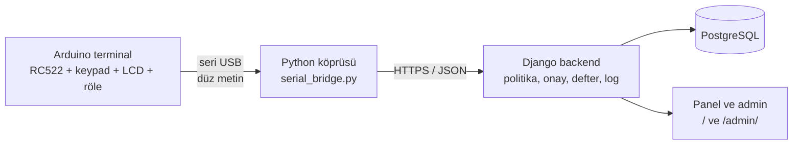

Arduino **hiçbir karar vermez**: kart UID'sini ve tuşları yollar, cevaba göre ekrana yazar. PIN doğrulama, bakiye,
politika, onay kuralları, defter ve log tamamen sunucudadır.

## Özellikler

| Özellik | Nerede | Nasıl görürsün |
|---|---|---|
| **N-of-M onay** (tutara göre 0–3 onay, rol şartı, 30 sn pencere) | `services.py` | README'deki demo |
| **Çift taraflı defter**: her hareket borç/alacak, bakiye defterden doğrulanır | `ledger.py` | `python manage.py gun_sonu_mutabakat` |
| **Idempotency**: aynı istek iki kez gelirse para iki kez çıkmaz | `services.islem_baslat` | Arduino ağ koparsa aynı anahtarla yeniden dener |
| **Günlük limit** + kasada yeterli nakit kontrolü | `Hesap.gunluk_limit` | admin panelinden değiştir |
| **Gün sonu mutabakatı**: defter ↔ bakiye ↔ işlem ↔ hash zinciri | `gun_sonu_mutabakat` | çıkış kodu 1 = fark var |
| **Anomali tespiti** (PIN saldırısı, gece işlemi, hızlı talepler…) | `anomali.py` | `python manage.py anomali_tara`, panel |
| **Kasa dairesi açma**: 3 onay + müdür, sonra röle | `kasa_acma_baslat`, firmware | yetkili kartı, "A:Kasa ac" |
| **PIN trafiği için HTTPS** + düz HTTP koruması | `https_sunucu.py`, köprü | aşağıda "HTTPS" |
| **HMAC'li hash zinciri** denetim kaydı | `hashlog.py` | `python manage.py log_dogrula` |
| **Çoklu terminal** + "imkânsız seyahat" kuralı | `Terminal`, `anomali.py` | admin panelinden terminal ekle |
| **Kuruş desteği** (klavyede `C` tuşu ondalık noktası) | firmware, `_tutar_coz` | `100.50` yaz |
| **Çevrimdışı günlük kuyruğu** (store-and-forward) | köprü, `terminal.py` | sunucuyu kapatıp terminali dene |
| **Bildirimler** (e-posta + SMS simülasyonu) | `bildirim.py` | talep açılınca yetkililere gider |
| **Maker-checker**: politika değişikliği 2 farklı kullanıcının onayını ister, korkuluklar, onaysız değişiklik tespiti | `politika_degisikligi.py` | admin → Politika değişikliği talepleri |
| **RBAC**: rol → yetki matrisi, admin grupları koddan, görev ayrımı denetimi | `rbac.py` | `python manage.py rbac_denetimi` |
| **Hassas yönetim işlemleri için maker-checker** (yetkili ekleme, rol, PIN, bloke, limit, terminal) | `yonetim_talepleri.py` | admin → Yönetim talepleri |
| **Web girişi**: hatalı deneme sınırı (kullanıcı ve IP başına, hash zincirinden sayılır), boşta oturum sonu, parola değiştirme, `/admin/login/` yan kapısı yok | `webgiris.py` | `/giris/` |
| **Müşteri PIN'ini terminalde kendisi değiştirir** (menüde `#`): açık oturum + eski PIN yeniden doğrulanır, yeni PIN iki kez girilir, mühür yenilenir, müşteriye SMS ile haber verilir | `services.pin_degistir` | simülatör: giriş → `#` |
| **Satır içi risk motoru**: çekme/havale uygulanmadan önce puanlanır; puana göre geçer, ek onay ister, reddedilir ya da kart bloke edilir; karar nedenleriyle zincire yazılır | `risk.py` | simülatör: farklı terminallerde aynı kart + hatalı PIN |
| **İmzalı kart (simülasyon)**: NTAG 424 DNA mantığı; kartın çipi her okutmada artan sayaç + MAC üretir, sunucu doğrular, klon ve tekrar oynatma reddedilir | `kart_imzasi.py` | simülatör: "Kart okutma türü" seçicisi |
| **Müşteri kartı ve PIN'i maker-checker'da**: kart tanımlama, PIN sıfırlama, telefon; PIN müşterinin telefonuna gider | `yonetim_talepleri.py` | admin → Yönetim talepleri |
| **Kart bütünlüğü**: satır başına HMAC mührü, sahte/değiştirilmiş kart yalnızca kendisi kapanır, ölçeklenir | `kart_butunlugu.py` | `python manage.py kart_goruntu_al` |
| **Bloke bütünlüğü**: veritabanından bloke kaldırma/ekleme log'dan türetilen beklenen durumla yakalanır | `bloke_butunlugu.py` | `python manage.py gun_sonu_mutabakat` |
| **Web ATM simülatörü**: tarayıcıda sanal terminal (LCD, tuş takımı, kartlar) + canlı şerit; gerçek servisleri kullanır | `simulator.py`, `static/banka/simulator.js` | `http://127.0.0.1:8000/simulator/` |
| **PIN gizliliği**: PIN yalnızca SMS sağlayıcıya verilir; log, veritabanı, panel ve e-postada görünmez | `sms.py` | `python manage.py sms_kutusu` |
| **Yetkili bütünlüğü**: sahte yetkili/rol/PIN değişikliği veritabanından yapılırsa onaylar kapanır | `personel_butunlugu.py` | `python manage.py personel_goruntu_al` |
| **Ters kayıt + para teslimi**: para alınmazsa çekme otomatik geri alınır (orijinal satırlara dokunmadan) | `services.teslim_bildir` | çekimde 8 sn içinde A tuşuna basma |
| **Banknot stoğu ve para dağıtımı**: tutar eldeki banknotlarla bölünür ve rezerve edilir; sıkışma, eksik verme ve bağlantı kopması güvenli yönetilir | `nakit.py`, `services.teslim_bildir`, `nakit_coz` | simülatörde "Para dağıtıcı" paneli, `python manage.py nakit_durumu` |
| **Banka operasyon simülasyonu**: panelden başlatılan 100 sanal müşterili yük testi (ayrı sandbox DB, Procrastinate görevi, Centrifugo canlı akışı); ATM yoğunluğu, kuyruk, başarısızlık ve onay gecikmesi raporu | `banka/operasyon/` | panel → Operasyon simülasyonu |
| **PostgreSQL ve eşzamanlılık**: aynı anda gelen işlemlerde bakiye, günlük limit, banknot stoğu ve PIN deneme sınırı aşılamaz | `kilit.py`, `services.py` | `python manage.py test` (eşzamanlılık testleri) |

## Ekran görüntüleri

Web ATM simülatörü (`/simulator/`): sanal terminal, para dağıtıcı ve demo kartları (canlı şerit aşağıda ayrı görselde).

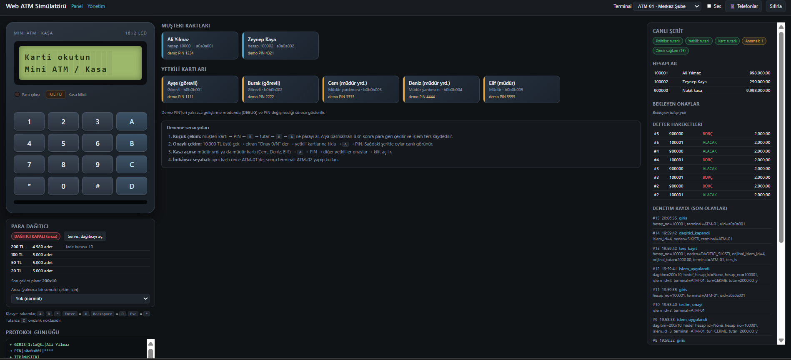

*Tam ekran görünüm: [docs/simulator-tam.png](docs/simulator-tam.png)*

Para dağıtıcı paneli: kasetler, rezerve edilen planlar ve kapanan dağıtıcı (sıkışma sonrası).

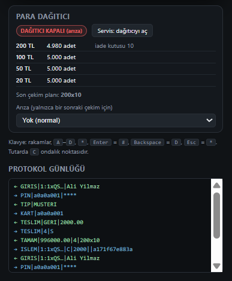

Canlı şerit: hesap bakiyeleri, bekleyen onaylar, defter hareketleri ve hash zincirli denetim kaydı (dağıtıcı kapanınca
anomali rozeti de uyarıya döner).

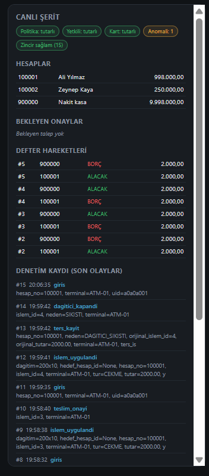

## Klasör yapısı

| Yol | Ne var |
|---|---|
| `arduino/atm_terminal/atm_terminal.ino` | Terminal yazılımı (kart, PIN, LCD menü, onay bekleme, röle) |
| `bridge/serial_bridge.py` | Seri port ↔ API köprüsü (`--konsol` ile Arduino'suz da denenir) |
| `backend/banka/models.py` | Müşteri, Hesap, Kart, Personel, Politika, İşlem, HesapHareketi, OnayTalebi, Onay, LogKaydi |
| `backend/banka/services.py` | PIN/bloke, oturum token'ı, politika, onay akışı, idempotency, limit, kasa açma |
| `backend/banka/ledger.py` | Defter satırları ve mutabakat |
| `backend/banka/anomali.py` | Log üzerinde anomali kuralları (sonradan tarama) |
| `backend/banka/risk.py` | Satır içi risk motoru: işlem anında puan, ek onay / ret / bloke |
| `backend/banka/hashlog.py` | Hash zinciri ekleme ve doğrulama |
| `backend/banka/terminal.py` | Terminal doğrulama, çevrimdışı günlüğün yüklenmesi |
| `backend/banka/bildirim.py` | E-posta ve SMS (simülasyon) bildirimleri |
| `backend/banka/baglam.py` | İsteğin terminalini log katmanına taşıyan bağlam |
| `backend/banka/politika_degisikligi.py` | Maker-checker, korkuluklar, politika bütünlüğü (onaylı görüntü) |
| `backend/banka/rbac.py` | Rol → yetki matrisi, admin grupları, görev ayrımı denetimi |
| `backend/banka/yonetim_talepleri.py` | Hassas yönetim işlemleri için maker-checker (11 işlem türü, nakit çözümü dahil) |
| `backend/banka/personel_butunlugu.py` | Yetkili kümesinin onaylı görüntüsü ve sapma tespiti |
| `backend/banka/kart_butunlugu.py` | Kart satırı mührü (HMAC), onaylı özet ve kart başına O(1) doğrulama |
| `backend/banka/bloke_butunlugu.py` | Bloke durumunu log'dan türetip veritabanıyla karşılaştırır |
| `backend/banka/sms.py` | SMS sağlayıcı soyutlaması (dosya/bellek) ve simülasyon gelen kutusu |
| `backend/banka/simulator.py` | Web ATM simülatörü: firmware satır protokolünü servislere çevirir, şerit verileri |
| `backend/banka/static/banka/simulator.js` | Simülatörün ekran akışı (firmware'in JS karşılığı) ve tarayıcı bağlantısı |
| `backend/js_testleri/simulator_akis.test.js` | Ekran akışının Node ile (sahte sunucuya karşı) testi |
| `backend/banka/api.py` | Köprünün konuştuğu JSON API |
| `backend/https_sunucu.py` | Geliştirme için HTTPS sunucusu |
| `backend/banka/tests.py` | Politika, onay, defter, idempotency, limit, anomali, kasa açma, zincir testleri |

## Kurulum (Windows)

Veritabanı artık **PostgreSQL** (SQLite yalnızca hızlı deneme içindir). Önce PostgreSQL'i ayağa kaldır, iki yoldan biriyle:

1. **Docker** (önerilen): repo kökünde `docker compose up -d`. `docker-compose.yml`, `settings.py` varsayılanlarıyla aynı
   bağlantıyı açar (veritabanı `kasa`, kullanıcı `kasa`, parola `kasa`, `127.0.0.1:5432`).
2. **Kendi PostgreSQL'in**: bir veritabanı ve kullanıcı oluştur (testler için kullanıcıda `CREATEDB` yetkisi gerekir),
   sonra `$env:POSTGRES_DB`, `$env:POSTGRES_USER`, `$env:POSTGRES_PASSWORD`, `$env:POSTGRES_HOST`, `$env:POSTGRES_PORT` ayarla.
   Örnek (psql ile, varsayılan ayarlarla uyumlu):

```sql
CREATE USER kasa WITH PASSWORD 'kasa' CREATEDB;
CREATE DATABASE kasa OWNER kasa;
```

```bat
cd backend
python -m venv .venv
.venv\Scripts\activate
pip install -r requirements.txt

python manage.py makemigrations banka
python manage.py migrate
python manage.py seed_demo
python manage.py createsuperuser
python manage.py test
python manage.py runserver
```

PostgreSQL kurmadan hızlıca denemek istersen (eşzamanlılık testleri atlanır): PowerShell'de `$env:DB_ENGINE="sqlite"` yaz ve
aynı komutları çalıştır. Ortam değişkenleri tek yerde: `backend/.env.example`.

Gereken Django sürümü **5.1 veya üstü**, sürücü `psycopg` 3 (`requirements.txt`). `seed_demo` sahte UID'li demo
müşteri/yetkili/politika, **nakit kasa hesabı** ve her terminale **banknot kasetleri** üretir, PIN'leri yazdırır
(müşteriler `1234` / `4321`, yetkililer `1111`…`5555`). Gerçek kartlarının UID'sini admin panelinden (`/admin/`) gir.

> **SQLite'tan geçiyorsan:** Demo veritabanı taşınmaz, PostgreSQL'de sıfırdan başlar (`migrate`, `seed_demo`). Eski
> `db.sqlite3` yalnızca `DB_ENGINE=sqlite` iken kullanılır. Yeni alanlar (banknot kasetleri, dağıtım planı, dağıtıcı durumu)
> için `makemigrations banka` bir migration üretir. `seed_demo`, onaylı başlangıç görüntülerini kaydeder, RBAC gruplarını
> kurar ve 8 demo yönetim kullanıcısı oluşturur (`politika_talep`, `politika_onay1-2`, `yonetim_talep`,
> `yonetim_onay1-3`, `denetci`); **şifreleri yalnızca ilk çalıştırmada ekrana yazar**, not al.

İkinci terminalde köprü:

```bat
cd bridge
pip install -r requirements.txt
python serial_bridge.py --port COM3 --terminal ATM-01
```

Bir kartın UID'sini öğrenmek için kartı terminale okut; köprü satırı `KART|c518cc4f -> TIP` diye yazdırır.
Seri port aynı anda tek programda açık olabilir, **Arduino IDE'nin Serial Monitor'unu kapat**.

Panel: `http://127.0.0.1:8000/` (staff girişi ister): anomali uyarıları, bekleyen onaylar, son işlemler, defter
hareketleri, hesaplar, zincir durumu.

## Bağlantılar (Uno)

| Parça | Pin |
|---|---|
| RC522 | SDA=10, RST=9, MOSI=11, MISO=12, SCK=13, **3.3V** |
| Keypad 4x4 | satırlar 2,3,4,5 — sütunlar 6,7,8,A0 |
| I2C LCD 16x2 | SDA=A4, SCL=A5 (adres `0x27`, olmazsa `0x3F`) |
| Buzzer | A1 |
| "Para çıkışı" LED'i | A2 |
| Kasa kilidi rölesi (IN) | A3 |

Kütüphaneler (Library Manager): **MFRC522**, **Keypad**, **LiquidCrystal I2C**.
Uno'da RAM dar; metinler bu yüzden `F()` ile flash'ta tutuluyor. "Low memory" uyarısı alırsan Mega ya da ESP32 kullan.

### Kasa kilidi (röle)

Arduino pini kilidi süremez. 5V röle modülü araya girer, kilit **ayrı 12V adaptörden** beslenir:

- Röle modülü: `VCC` → 5V, `GND` → GND, `IN` → A3
- Adaptör `+` → rölenin `COM`; rölenin `NO` → kilidin `+`; kilidin `-` → adaptör `-`
- Kilidin uçlarına ters yönde bir **1N4007 diyot** bağla (bobinin gerilim sıçramasını söndürür)
- Çoğu modül LOW'da çeker. Seninki tersse `atm_terminal.ino` içinde `ROLE_ACIK` ile `ROLE_KAPALI` değerlerini yer değiştir.
- İlk denemede kilit yerine LED ya da rölenin "klik" sesiyle dene. Kilit 5 sn açık kalır (`KILIT_ACIK_MS`).

## Terminal ekranları

16x2 LCD'de görünen ekranlar. 1-13, 15 ve 20-22 numaralı ekranlar `atm_terminal.ino` ile simülatörde aynıdır (11-13: PIN değiştirme, 22: imzalı kart reddi); 14 ve 16-19 numaralı
para dağıtıcı ekranları (sayım, sıkışma, eksik verme, bağlantı kopması) yalnızca simülatörde oynatılır, çünkü Arduino'da dağıtıcı donanımı yoktur.
Görsel `python docs/lcd_uret.py` ile üretilir:

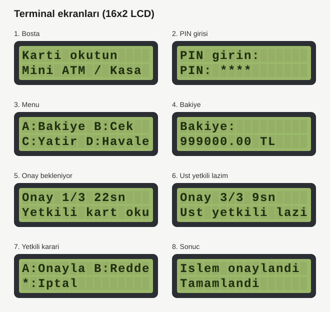

## Kurallar (varsayılan politika, admin panelinden değişir)

| Tutar (çekme / havale) | Gereken onay |
|---|---|
| ≤ 5.000 | Onay yok |
| 5.000 – 50.000 | 1 yetkili |
| 50.000 – 500.000 | 2 yetkili, en az biri müdür yardımcısı veya üstü |
| > 500.000 | 3 yetkili, en az biri müdür |

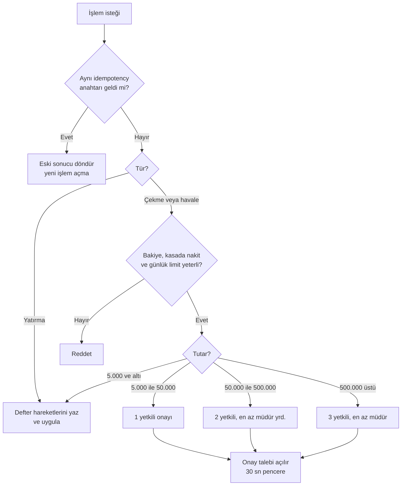

- Yatırma onaysız geçer ve günlük limite takılmaz.
- **Günlük limit** (varsayılan 1.000.000 TL/hesap) bugünkü uygulanmış ve onay bekleyen çekme/havaleleri sayar.
- Çekme için **kasada yeterli nakit** de gerekir (`seed_demo` kasaya 10.000.000 TL koyar).
- Onaylar talep açıldıktan sonra `ONAY_PENCERESI_SN` (varsayılan 30 sn) içinde toplanmalı, yoksa talep düşer. Demo/simülatör için
  ortam değişkeniyle uzatılabilir (10–600 sn): PowerShell'de `$env:ONAY_PENCERESI_SN=120` yazıp `runserver`'ı o pencerede başlat.
- Aynı yetkili iki kez sayılmaz. İşlemi başlatan kendi işlemini onaylayamaz. Herhangi bir yetkili reddedebilir.
- **Mesai dışı** (09–18 dışı ve hafta sonu) onay isteyen işlemlerde **+1 onay** ve **bir üst rol** gerekir.
  Gece denerken fazladan onay istemesini istemiyorsan: `set MESAI_DISI_KURALI=0` (sonra `runserver`).
- Aktif yetkili sayısı ya da gerekli rol yetmiyorsa işlem açılmaz (güvenli tarafta kalır).
- 3 yanlış PIN kartı bloke eder (müşteri ve yetkili). Blokeyi admin panelinden kaldır.

## Akış

600.000 TL çekme örneği (3 onay, en az biri müdür):

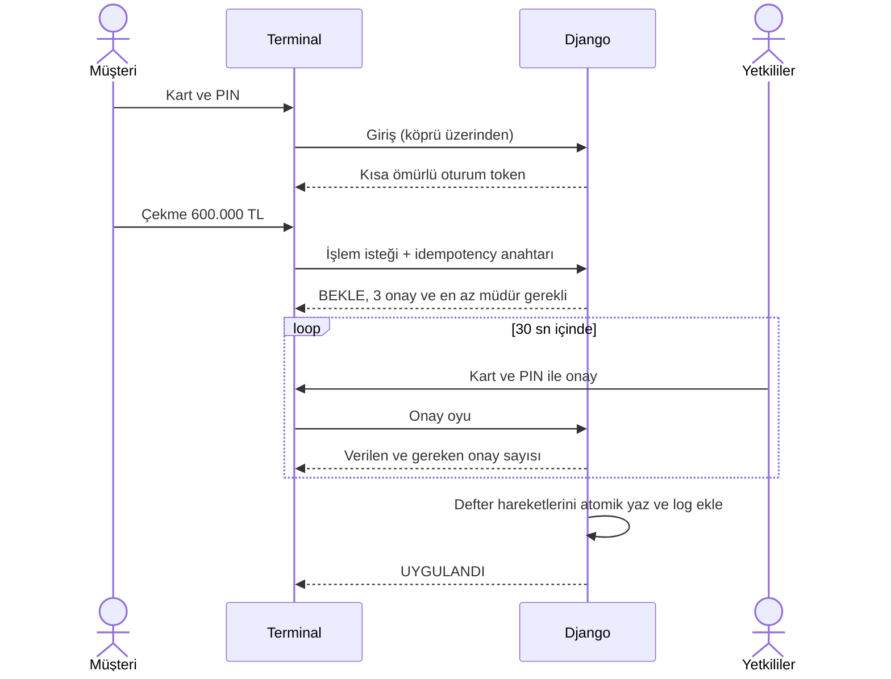

Onay talebinin yaşam döngüsü:

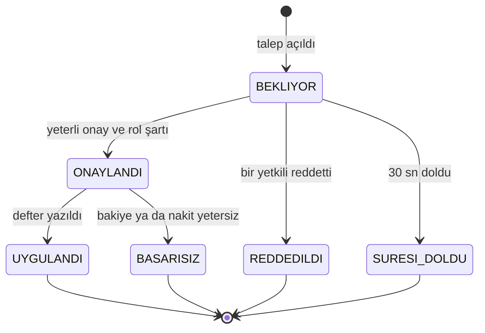

## Kasa dairesini açma

Bekleyen talep yokken **müdür yardımcısı ya da müdürün kartını** okut → `A:Kasa ac` → PIN (görevli rolünün bu yetkisi yok, bkz. RBAC). 3 onay gerekir ve en az biri müdür olmalıdır
(`KASA_ACMA_GEREKEN_ONAY`, `KASA_ACMA_EN_AZ_ROL`). Diğer yetkililer kartlarını okutup onaylar; **talebi başlatan kendi
talebini onaylayamaz**, bu yüzden onaylayabilecek başka yeterli yetkili yoksa talep hiç açılmaz (tek müdürün
başlattığı talep sonsuza dek takılırdı). Son onayda sunucu `UYGULANDI` der ve terminal röleyi 5 sn çeker.

## Çift taraflı defter ve mutabakat

Bakiye tek bir sayı değildir; her para hareketi, toplamı sıfır olan borç/alacak satırlarıdır:

| İşlem | Borç | Alacak |
|---|---|---|
| Çekme | müşteri hesabı | kasa |
| Yatırma | kasa | müşteri hesabı |
| Havale | gönderen müşteri | alıcı müşteri |

`Hesap.bakiye` hızlı okuma için tutulan önbelleğdir. `Hesap.acilis_bakiyesi` + defterin net etkisi gerçek bakiyedir.

```bat
python manage.py gun_sonu_mutabakat                 :: bugün
python manage.py gun_sonu_mutabakat --tarih 2026-11-05
```

Komut şunları karşılaştırır, fark varsa çıkış kodu 1 verir ve sonucu denetim loguna yazar:
kayıtlı bakiye ↔ defterden hesaplanan bakiye, her işlemde borç = alacak = tutar, uygulanmış işlemin defter satırı olması,
uygulanmamış işleme ait yetim satır olmaması, hash zincirinin sağlamlığı.

## Idempotency

Ağ koparsa ya da cevap gecikirse aynı istek iki kez gelebilir. Terminal her işlem için rastgele bir **anahtar** üretir;
cevap gelmezse AYNI anahtarla en fazla 2 kez yeniden dener. Sunucu `(hesap, anahtar)` çiftini tekil tutar: ikinci istek
yeni işlem açmaz, ilk işlemin sonucunu döndürür (`"tekrar": true`). Aynı anahtar farklı tutar/hedefle gelirse reddedilir.

## Anomali tespiti

```bat
python manage.py anomali_tara --saat 24        :: yüksek ciddiyette bulgu varsa çıkış kodu 1
```

| Kural | Ciddiyet | Ne yakalar |
|---|---|---|
| `pin_yagmuru` | yüksek | Aynı kimlikte 10 dk içinde 3+ hatalı PIN |
| `dagitik_pin` | yüksek | 10 dk içinde 3+ farklı kimlikte toplam 5+ hatalı PIN |
| `bilinmeyen_kart_tekrar` | orta | Tanımsız kartın 10 dk içinde 3+ kez okutulması |
| `bloke_kart_denemesi` | orta | Bloke kimlikle ısrarlı deneme |
| `hizli_talep` | orta | Aynı hesapta 10 dk içinde 3+ onay talebi |
| `gece_yetkili_islemi` | orta / yüksek | 00:00–05:00 arasında onay ya da kasa açma |
| `imkansiz_seyahat` | yüksek | Aynı kart/yetkili, kısa sürede birbirine uzak iki terminalde (varsayılan eşik 150 km/sa) |
| `farkli_terminal_kisa_surede` | orta | Terminal konumu bilinmiyorsa: aynı kimlik 2 dk içinde iki terminalde |
| `uzun_cevrimdisi` | orta | Terminal 30 dk'dan uzun çevrimdışı kaldı (terminalin kendi beyanı) |
| `teslim_belirsiz` | orta | Nakit çekmenin para teslimi 5 dk'dan uzun süredir bildirilmedi |
| `cok_ters_kayit` | orta | Aynı hesapta 60 dk içinde 3+ ters kayıt (dağıtıcı arızası ya da suistimal) |
| `kart_klon_suphesi` | yüksek | İmzalı kartta geçersiz imza, tekrar oynatma ya da imzasız kart (zorunlu modda) |
| `riskli_islem` | orta / yüksek | Risk motoru ek onay istedi (orta), işlemi reddetti ya da kartı bloke etti (yüksek) |

Bu kurallar olaylara **sonradan** bakar ve rapor eder. İşlem anında durduran kısım aşağıdaki "Satır içi risk motoru"dur.

Kurallar hash zincirli logdaki olaylara bakar, bulgular panelin üstünde görünür. Kimlik başına son görüldüğü terminal tutulur; terminal koordinatları varsa haversine mesafesi ve hız hesaplanır.
`python manage.py anomali_tara --bildir` yüksek ciddiyetteki bulguları müdür yardımcısı ve üstüne bildirir.

## Satır içi risk motoru

`anomali.py` raporlar; `risk.py` ise para çekme ve havale anında, hesap satırı ve zincir kilidi **altında** çalışır ve işlemi durdurabilir.
Yatırma ve bakiye sorgusu kapsam dışıdır (para vermezler).

Puan, bağımsız faktörlerin toplamıdır:

| Faktör | Puan | Ne yakalar |
|---|---|---|
| `pin_hatali` | 15 (en çok 45) | Son 30 dk'da bu kartta hatalı PIN, her biri için |
| `imkansiz_seyahat` | 60 | Aynı kart 30 dk içinde uzak bir terminalde de kullanıldı, hız eşiği aşılıyor |
| `farkli_terminal` | 25 | Aynı kart 10 dk içinde başka terminalde de kullanıldı (konum yok ya da hız makul) |
| `olagan_disi_tutar` | 30 | Tutar, hesabın 90 günlük ortalamasının 3 katından ve geçmiş en büyüğünden fazla (en az 3 işlem varsa) |
| `yeni_hesap_buyuk` | 15 | Geçmişi az (3'ten az işlem) hesapta `RISK_YENI_HESAP_TUTAR` ve üstü |
| `islem_hizi` | 20 / 35 | Hesapta son 10 dk'da 3+ / 5+ çekme ya da havale |
| `gece` | 10 | 00:00–05:00 arası |
| `kart_imzasi` | 40 | Son 24 saatte bu kartta imza ihlali (klon, tekrar oynatma, imzasız) |

| Puan | Karar | Ne olur |
|---|---|---|
| < 40 | geç | Normal akış (puan işlemde saklanır) |
| ≥ 40 | **ek onay** | Politika ne derse desin en az 1 yetkili onayı (`RISK_EK_ONAY_SAYISI`); politika daha fazlasını istiyorsa o geçerlidir. Yetkililere giden bildirimde risk gerekçesi yazar |
| ≥ 80 | **ret** | İşlem oluşmaz, müşterinin telefonuna SMS gider |
| ≥ 120 | **bloke** | Ret + kart bloke. Beklenen durum log'dan türetilir (`risk_bloke`), yani veritabanından blokeyi silmek işe yaramaz; kaldırma maker-checker talebiyle olur |

Her karar `risk_karari` olayıyla (puan, faktör kodları) hash zincirine yazılır ve işlemde `risk_skoru` / `risk_notu` olarak görünür;
anomali taraması `riskli_islem` bulgusu üretir. Eşikler ayarlardan değişir (`.env.example`: `RISK_*`). Açık oturum token'ı, kart
sonradan bloke edilse de (ya da bloke alanı veritabanında sıfırlansa da) işlem yaptıramaz.

**Dürüst sınırlar:**

- Faktörler ve eşikler elle seçilmiştir; gerçek dolandırıcılık verisiyle ayarlanmamıştır. Yanlış pozitif meşru müşteriyi engelleyebilir,
  bu yüzden önce ek onay basamağı vardır ve bloke yalnızca birkaç güçlü sinyal birleşince olur (ör. imkânsız seyahat + imza ihlali + hatalı PIN).
- Eşikler Politika tablosunda değil ayarlardadır; yani maker-checker ile değişmezler (kod/ortam değişikliği gerektirir).
- Testlerde varsayılan olarak kapalıdır (`RISK_MOTORU_AKTIF`); risk testleri açıkça açar. Üretimde açık olmalıdır.
- Bir ML katmanı (RandomForest/IsolationForest gibi) yoktur; eklenirse kural skorunu değiştirmez, yanına bir sinyal olarak girer.

**Simülatörde deneme:** (şeritte "Risk motoru: açık" rozeti görünür)

1. ATM-01'de müşteri kartıyla giriş yap, ardından ATM-02'de aynı kartla giriş yap ve çek: imkânsız seyahat (Istanbul → Ankara) puanı 60,
   işlem **ek onay** bekler ("Onay gerekli" ekranı).
2. Önce iki kez yanlış PIN gir (üçüncüsü kartı kilitler), sonra yukarıdaki adımları yap: puan 90, işlem **reddedilir**.

## HTTPS (PIN trafiği)

PIN, Arduino → köprü arası USB'den düz gider (aynı bilgisayar). Köprü → API arası ise ağdan geçebilir; bu yüzden:

- Köprü, **bu bilgisayar dışındaki bir adrese düz HTTP ile bağlanmayı reddeder** (`--guvensiz-http` ile bilerek açılır).
- `DJANGO_HTTPS=1` ise API düz HTTP isteklerini `403` ile reddeder, oturum/CSRF çerezleri `Secure` olur.
- `backend/https_sunucu.py` geliştirme için TLS'li sunucu açar (üretimde gunicorn/waitress + Caddy/nginx kullan).

```bat
mkcert -install
mkcert localhost 127.0.0.1 ::1
set DJANGO_HTTPS=1
python https_sunucu.py --sertifika localhost+2.pem --anahtar localhost+2-key.pem

python serial_bridge.py --port COM3 --api https://127.0.0.1:8443 --ca-dosyasi "<mkcert -CAROOT klasörü>\rootCA.pem"
```

**Neden PIN'i Arduino'da hash'lemiyoruz?** 4 haneli PIN'in 10.000 olasılığı var; hash'i ele geçiren herkes saniyeler içinde
PIN'i bulur, üstelik hash'in kendisi "PIN yerine geçen sır" olur (pass-the-hash). Asıl koruma kanalın şifrelenmesi,
sunucuda yavaş hash (Django PBKDF2) ve deneme sınırıdır. Gerçek sistemlerde PIN, güvenli PIN-pad içinde şifrelenir (PIN block) ve HSM ile doğrulanır.

## Arduino olmadan deneme (köprü konsol modu)

```bat
python serial_bridge.py --konsol
```

```
KART|a0a0a001
PIN|a0a0a001|1234                 <- GIRIS|<token>|Ali Yilmaz
ISLEM|<token>|C|600000||anahtar1  <- BEKLE|1|3   (token 120 sn geçerli)
ISLEM|<token>|C|600000||anahtar1  <- BEKLE|1|3   (aynı anahtar: yeni talep açılmaz)
ONAY|1|b0b0b001|1111|E            <- ONAY|1|3|BEKLIYOR
ONAY|1|b0b0b002|2222|E
ONAY|1|b0b0b003|3333|E            <- 3 onay var ama müdür yok: BEKLIYOR, üst rol lazım
ONAY|1|b0b0b005|5555|E            <- UYGULANDI

KASAAC|b0b0b003|3333              <- BEKLE|2|3   (kasa dairesi açma talebi; Cem müdür yrd.)
ONAY|2|b0b0b001|1111|E            ... Ayşe, Burak, Elif onaylar; Cem kendi talebini onaylayamaz,
                                      görevli (Ayşe) talebi başlatamaz (HATA|Bu rol kasa acma talebi baslatamaz)
```

## Terminaller ve imkânsız seyahat

Her köprü kendini `--terminal ATM-01` ile tanıtır (`X-Terminal-Id` başlığı). Terminaller admin panelinde tanımlıdır
(kod, ad, enlem, boylam); tanımsız ya da kapatılmış terminal `403` alır, başlık yoksa `ATM-01` varsayılır.
Terminal kodu **her denetim kaydına** ve `Islem.terminal` alanına yazılır (hash zincirine de girer).

`seed_demo` iki terminal ekler: `ATM-01` (Ankara) ve `ATM-02` (İstanbul), aralarında yaklaşık 350 km var.
Aynı kartı iki terminalde birkaç saniye arayla kullanırsan `imkansiz_seyahat` alarmı çıkar. Birbirine 1 km'den yakın
terminaller aynı şube sayılır. Kasa açma talebini başlatan terminalin röle kilidi açılır, çünkü yalnızca talebi başlatan
terminal onu sorgular.

## Kuruş

Klavyede tutar girerken `C` tuşu ondalık noktasıdır (en fazla 2 hane): `1 0 0 C 5` → `100.5` → `100,50 TL`.
Sunucu nokta ve virgülü kabul eder, 3. ondalık haneyi **reddeder** (sessizce yuvarlamaz) ve `1,000.50` gibi
belirsiz binlik ayraçlarını da reddeder. Defter kuruşla dengeli kalır. **Nakit çekmede kuruş yoktur**: ATM yalnızca
banknot verir, çekilen tutar banknotlarla oluşmalıdır (örn. 10 TL'nin katı); kuruş yatırma ve havalede geçerlidir.

## Çevrimdışı davranış

Terminal sunucuya ulaşamazsa **para işlemi yapılmaz** ("Sunucu kapali"). Bu bilinçli bir sınırdır: PIN doğrulayıcıları
ve bakiyeler yalnızca sunucuda durur. Terminale koymak, "PIN'i Arduino'da hash'lemiyoruz" kararıyla çelişirdi ve
çevrimdışı bir çekimi kimse denetleyemezdi.

Bunun yerine köprü **store-and-forward günlük** tutar (`bridge/cevrimdisi_kuyruk.jsonl`):

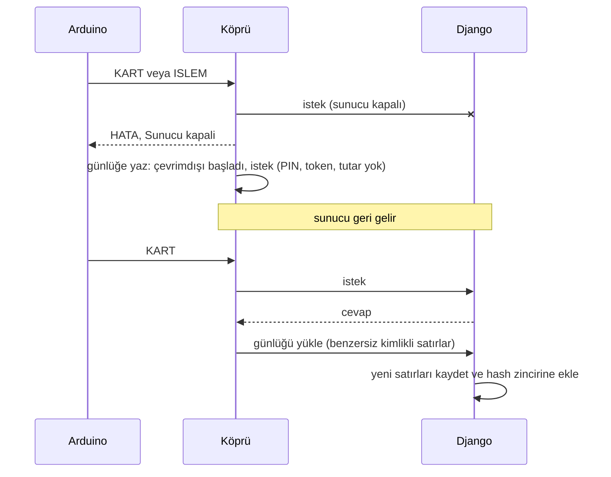

- Köprü sunucuya bağlanamayınca 5 sn boyunca hiç denemeden "kapalı" der (devre kesici), Arduino beklemez.
- Günlüğe yalnızca olay türü, komut adı ve kart UID'si yazılır. **PIN, token ve tutar yazılmaz.**
- Her satırın benzersiz kimliği vardır; yükleme cevabı kaybolup yeniden gönderilse bile sunucuda bir kez kaydedilir.
- Satırdaki zaman **terminalin beyanıdır**: 7 günden eskiyse ya da gelecekteyse `zaman_guvenilir=false` olarak işaretlenir.
- Cevap gecikirse (bağlantı var, yanıt yok) terminal çevrimdışı sayılmaz: istek uygulanmış olabilir, Arduino aynı
  idempotency anahtarıyla tekrar dener.
- Dosya 1000 satırı geçmez (en eskiler atılır).

Çevrimdışıyken bile işlem yapılabilen bir "stand-in" mod (önceden yetkilendirilmiş küçük limit) **henüz yok**; tasarım taslağı aşağıda.

### Tasarım taslağı: stand-in mod (uygulanmadı)

Gerçek bankalarda "stand-in processing": ATM sunucuya ulaşamazken, sunucunun önceden verdiği küçük bir yetkiyle işlem yapar.
Risk, baştan kabul edilmiş tavan sınırlarla çevrelenir.

**Akış**

1. Sunucu çevrimiçiyken terminale kısa ömürlü, HMAC imzalı bir **stand-in belgesi** verir: terminal kodu, geçerlilik süresi,
   işlem başına limit, terminal toplam limiti, kart başına çevrimdışı günlük limit (ör. 500 TL / 3.000 TL / 1.000 TL).
2. Sunucu kapanırsa köprü belgeyi kullanır; yalnızca **imzalı kartla** ("İmzalı kart" bölümü)
   ve belge limitleri içinde nakit çekime izin verir. Sayaç ve harcama toplamı köprüde tutulur, işlem kuyruğa yazılır.
3. Sunucu dönünce kuyruk, idempotency anahtarlarıyla sırayla yüklenir ve deftere işlenir. Bakiye yetmeyen işlem
   "risk üstlenildi" olarak işaretlenir (hesap eksiye düşebilir), anomali olarak raporlanır ve müşteriye bildirilir.
4. Belge süresi dolarsa ya da toplam limit biterse terminal yine "Sunucu kapali" der.

**Açık sorunlar ve kararlar**

| Sorun | Taslak karar |
|---|---|
| Çevrimdışı PIN doğrulanamaz (doğrulayıcı yalnızca sunucuda) | PIN'i terminale koymuyoruz. Çevrimdışıyken PIN yerine imzalı kart + düşük limit; gerçek çözüm EMV'deki çevrimdışı PIN (çipli kart) |
| Aynı kart iki terminalde çevrimdışı harcayabilir (çift harcama) | Kart başına çevrimdışı limit belgede, sayaç terminal başına; yükleme sırasında aşım tespit edilip kayda geçer. Tamamen kapanmaz, limit riski sınırlar |
| Terminalin zamanı güvenilmez | Belgenin süresi sunucu zamanıyla verilir; yüklenen satırlar `zaman_guvenilir` mantığıyla işaretlenir |
| Köprüdeki belge çalınabilir | Belge yalnızca o terminale ve kısa süreliğine geçerli; sunucu belgeyi iptal listesine alabilir, yükleme sırasında doğrular |
| Yükleme tekrarı ya da çift gönderim | Her çevrimdışı işlemin benzersiz kimliği ve idempotency anahtarı var; sunucu bir kez uygular |
| Çevrimdışı işlemin hash zincirine eklenmesi | Zincire yükleme anında eklenir; orijinal terminal zamanı ayrı alanda tutulur |

**Uygulanırsa:** `StandInBelgesi` modeli ve imzası, köprüde belge/limit/kuyruk, `/api/standin/` (belge al, işlemleri yükle),
anomali kuralı (aşım, risk üstlenilen işlem), simülatörde "sunucuyu kes" düğmesi ve testler.

## Bildirimler

| Olay | Kime | Kanal |
|---|---|---|
| Onay talebi açıldı (çekme/havale ya da kasa açma) | Aktif yetkililer, **talebi başlatan hariç** | e-posta + SMS |
| Kasa dairesi açıldı | Müdür yardımcısı ve üstü | e-posta + SMS |
| Yüksek ciddiyetli anomali (`anomali_tara --bildir`) | Müdür yardımcısı ve üstü, aynı bulgu 6 saatte bir | e-posta + SMS |

- E-posta Django'nun e-posta altyapısıyla gider; varsayılan olarak **konsola yazar**. Gerçek SMTP için
  `DJANGO_EMAIL_BACKEND=django.core.mail.backends.smtp.EmailBackend` ve `EMAIL_HOST` gibi ayarları ver.
- **SMS gerçek değildir**: kayıt `SMS (simülasyon)` olarak tutulur ve loga yazılır; gerçek bir sağlayıcı bağlı değil.
- Yetkililerin e-posta ve telefonu admin panelinde (`Personel`) girilir. Demo adresleri `.example` uzantılıdır, gerçek değildir.
- Bildirim hatası **işlemi bozmaz**: hata `Bildirim` tablosuna `BASARISIZ` olarak yazılır. Bildirimler işlem
  commit edildikten sonra gönderilir. Panelde "Son bildirimler" bölümü var.
- Bloke ya da pasif yetkililere bildirim gitmez.

## Politika değişikliği: maker-checker

Onay politikası (hangi tutarda kaç onay) sistemin en kritik ayarıdır; tek kişi "50.000 TL'ye kadar onaysız" yazarsa
bütün N-of-M düzeni boşa gider. Bu yüzden **Politika tablosu admin panelinde salt okunurdur** (ekleme, değiştirme ve
silme kapalı). Değişiklik yalnızca "Politika değişikliği talepleri" ile yapılır:

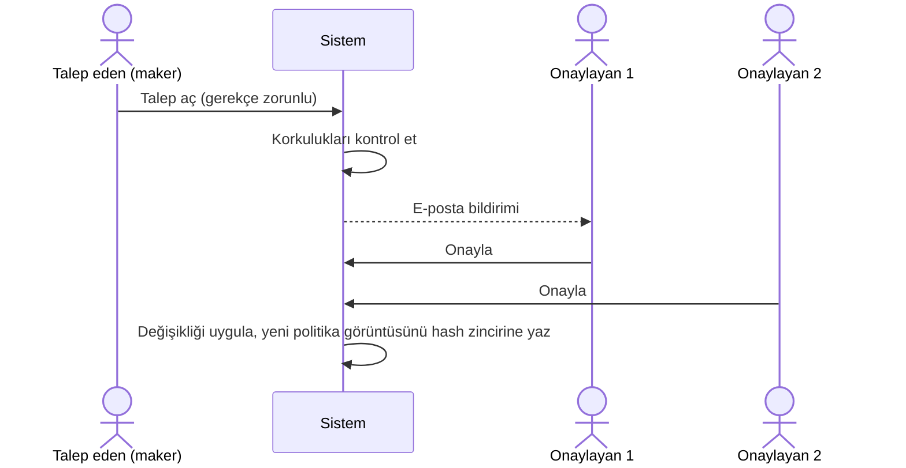

- Talep eden kendi talebini **onaylayamaz**, aynı kullanıcı iki kez sayılmaz, herhangi bir onaylayan reddedebilir,
  talep 24 saat içinde onaylanmazsa düşer. Aynı politika için aynı anda tek bekleyen talep olabilir.
- Yetki Django izinleriyle verilir: `politika_talep_et` (maker) ve `politika_onayla` (checker). `seed_demo` iki grup
  ve üç demo kullanıcı kurar (1 talep eden + 2 onaylayan). Gereken onay sayısı `POLITIKA_DEGISIKLIK_ONAY` (varsayılan 2).
- Aralıkta yalnızca **alt limit** girilir; üst limit bir sonraki aralığın alt limitinden türetilir, böylece boşluk ve
  çakışma olamaz. Yeni eşik eklemek bir aralığı böler, silmek öncekini uzatır.

**Korkuluklar (onaylansa bile aşılamaz, panelden değişmez, `settings.py`'dedir):**

| Kural | Neden |
|---|---|
| Onaysız (0 onay) aralık en fazla `POLITIKA_ONAYSIZ_AZAMI_TUTAR` (10.000 TL) olabilir | Büyük işlemi onaysız bırakmak engellenir |
| Tutar arttıkça gereken onay sayısı ve rol azalamaz | "Daha büyük tutar, daha az kontrol" olamaz |
| En üst aralık en az `POLITIKA_EN_UST_ARALIK_MIN_ONAY` (2) onay ister | En büyük işlem tek imzayla geçemez |
| İlk aralık 0'dan başlar, alt limitler tekil, onay ≤ `POLITIKA_MAKS_ONAY` | Kapsama ve tutarlılık |

**Onaysız değişikliği yakalamak (bütünlük):** Her onaylı değişiklikte politika tablosunun özeti (SHA-256) hash zincirine
yazılır. Tablo bu "onaylı görüntü"den farklıysa (ör. veritabanına doğrudan müdahale) sistem **kapalı kalır**: her
çekme/havale en sıkı kuralla (3 onay, müdür) istenir, `politika_butunluk_ihlali` loga yazılır (saatte bir) ve
`gun_sonu_mutabakat` hata verir. Tablo onaysız değiştirilmişken yeni bir politika talebi de uygulanmaz.
`politika_goruntu_al` ilk kurulumda başlangıç görüntüsünü yazar; tablo farklıyken meşrulaştırmayı reddeder, bilerek
yapılacaksa `--zorla` ister ve denetim kaydına işlenir.

Dürüst sınırlar: Maker-checker, kullanıcı yönetimi kadar güvenlidir. Bir superuser ek kullanıcı oluşturup kendi talebini
başka hesapla onaylayabilir; gerçek sistemde kullanıcı ve yetki yönetimi de aynı şekilde onaya bağlı olurdu. Tek talep,
geçerli bir politika kümesi bırakmak zorundadır (ara geçersiz durum yok). Kasa açma kuralı (`KASA_ACMA_*`) ve
korkuluk eşikleri ayarlardadır, yani değişiklikleri kod incelemesinden geçer.

## Ters kayıt ve para teslimi

Nakit çekmede "UYGULANDI" paranın müşteriye ulaştığı anlamına gelmez. Bu yüzden her çekme `teslim=BEKLIYOR` ile başlar ve
**teslim bildirimi** bekler:

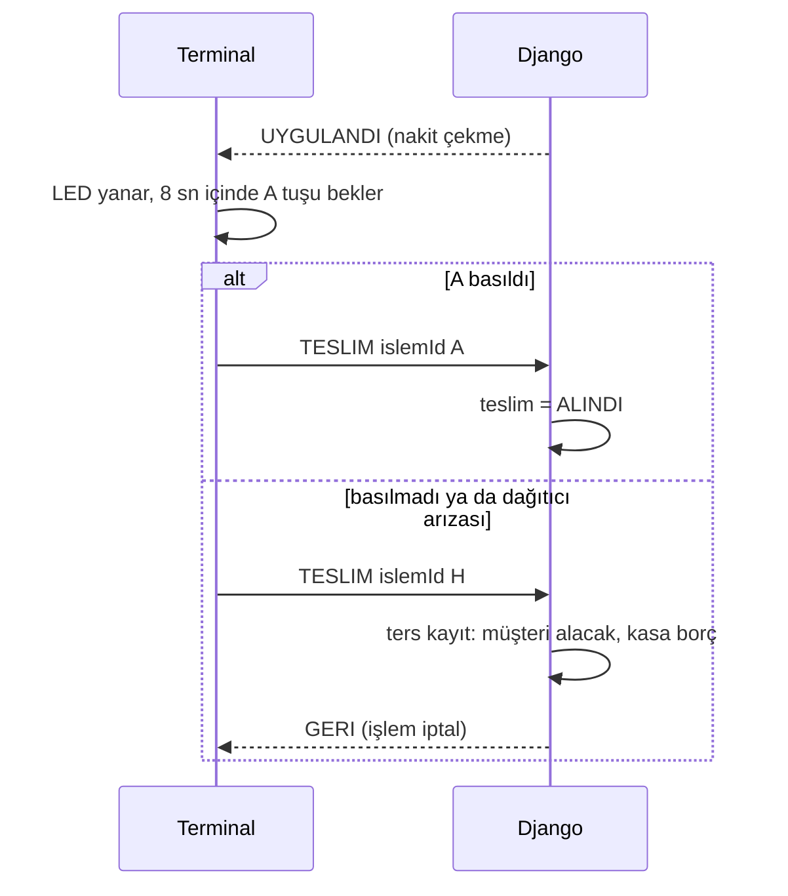

- **Orijinal defter satırlarına dokunulmaz.** Geri alma, yeni bir `TERS_KAYIT` işleminin ters borç/alacak satırlarıdır
  (çekmede: müşteri **alacak**, kasa **borç**). Bir çekme en fazla bir kez ters kaydedilir (veritabanı kısıtı).
- Teslimi yalnızca **işlemi başlatan terminal**, işlemden sonra `TESLIM_PENCERESI_SN` (120 sn) içinde bildirebilir.
  Aynı bildirim tekrarlanırsa aynı sonuç döner (ağ kopması güvenli). Bildirilen sonuçla çelişen ikinci bildirim reddedilir.
- Yalnızca **nakit çekme** ters kaydedilir. Yatırma ve havalenin geri alınması alıcının bakiyesine ve rızasına bağlı
  olduğu için bilinçli olarak kapsam dışıdır.
- Ters kaydedilen çekme günlük limiti tüketmez; aynı idempotency anahtarıyla yeniden gelen istek "başarılı" döndürmez.
- Ters kayıtlar müdür yardımcısı ve üstüne bildirilir. `gun_sonu_mutabakat` her ters kaydın uygulanmış bir çekmeyi
  (aynı hesap, aynı tutar) geri aldığını ve geri alınmış her çekmenin tam bir ters kaydı olduğunu doğrular; teslimi
  10 dk'dan uzun süredir bildirilmeyen çekmeleri uyarı olarak listeler. Anomali tarayıcı da bunları (`teslim_belirsiz`,
  `cok_ters_kayit`) işaretler.
- **Simülasyon notu:** Gerçek ATM'de "para alındı" bilgisini dağıtıcının sensörü verir. Burada A tuşu o sensörü taklit
  eder; bu yüzden bir müşteri parayı alıp tuşa basmayarak iade alabilirdi. Gerçek bir sensörde bu mümkün olmaz.
- Terminal hiç bildirmediyse (bağlantı koptu) teslim **otomatik iade edilmez**; `BELIRSIZ` olur ve yalnızca operatör
  sayımıyla (`nakit_coz`, yapan ve gerekçe hash zincirine yazılır) sonuçlanır. Ayrıntılar: "Banknot stoğu ve para dağıtımı".

## Banknot stoğu ve para dağıtımı

Para çekerken tutarın bakiyeye yetmesi yetmez, **eldeki banknotlarla verilebilmesi** gerekir. Her terminalin kasetleri
(`Kaset`: 200 / 100 / 50 / 20 TL, ayar `BANKNOT_NOMINALLERI`) ayrı tutulur:

| Alan | Anlamı |
|---|---|
| `adet` | kasette duran banknot (rezerve edilenler dahil) |
| `rezerve` | planlanmış ama teslim sonucu henüz gelmemiş banknot; **kullanılabilir = adet − rezerve** |
| `iade_kutusu` | geri çekilen ya da sıkışan banknot; kasete geri konmaz, teknik servis sayar |

**Çekim akışı** (2.000 TL örneği):

1. Tutar 10 TL'nin katı olmalı (ayarlardaki banknotların ortak böleni) ve bu banknotlarla oluşmalı (10 ve 30 TL verilemez).
2. Tutar, kasetlerdeki **gerçek stokla en az banknotla** bölünür: bol stokta `200x10`; 200'lükler az ise `200x5+100x10`.
   Stok yetmezse çekim reddedilir (`ATM'de bu tutar için banknot yok`), para hiç hareket etmez.
3. Plan **rezerve edilir** (iki eşzamanlı çekim aynı banknotu sayamaz). Onay isteyen çekimde stok önce kontrol edilir,
   asıl rezervasyon onay anında yapılır; bu arada stok bitmişse işlem `BASARISIZ` olur ve defter hiç değişmez.
4. Dağıtım planı işleme yazılır (`Islem.dagitim_plani`) ve terminale `TAMAM|bakiye|islemId|200x10` ile gider.
5. Terminal sonucu bildirir; stok buna göre kapanır:

| Olay | Terminal bildirimi | Bakiye | Banknotlar | Dağıtıcı |
|---|---|---|---|---|
| Para alındı | `TESLIM\|id\|A` | düşük kalır | kasetten düşer | açık |
| Müşteri almadı (geri çekildi) | `H` | tam iade (ters kayıt) | iade kutusuna | açık |
| **Para sıkıştı** (hiç verilmedi) | `S` | tam iade | iade kutusuna | **kapanır** |
| **Eksik verildi** (örn. 9/10 banknot) | `K\|200x9` | **yalnızca fark** iade | verilenler düşer, kalan iade kutusuna | **kapanır** |
| **Bağlantı koptu** (sonuç gelmedi) | yok | **dokunulmaz** | rezerve kalır | açık |

**Sıkışma ve eksik verme:** Dağıtıcı kapanır (başka müşteri aynı arızaya uğramasın), müdür yardımcısı ve üstüne bildirim
gider, anomali tarayıcı `dagitici_arizasi` bulgusu üretir. Eksik vermede yalnızca fark ters kaydedilir (`iade_tutari`),
günlük limite de yalnızca fiilen verilen kısım sayılır. Teknik servis kasetleri sayar ve açar:

```bat
python manage.py nakit_durumu
python manage.py kaset_doldur --terminal ATM-01 --nominal 200 --adet 3000 --yapan "Ali Teknisyen" --iade-kutusunu-bosalt
python manage.py dagitici_ac --terminal ATM-01 --yapan "Ali Teknisyen" --neden "Rulo degistirildi"
```

**Bağlantı koparsa üç farklı an vardır:**

- *İstek sunucuya ulaşmadan ya da cevap dönmeden:* terminal **aynı idempotency anahtarıyla** yeniden dener; sunucu aynı
  sonucu (aynı plan dahil) verir, para ve banknot bir kez düşer.
- *Para verildi ama sonuç bildirilemedi:* `TESLIM_PENCERESI_SN` (120 sn) içinde bildirim gelmezse teslim **`BELIRSIZ`** olur.
  Para **otomatik iade edilmez**: müşteri parayı almış olabilir, iade çift ödeme olurdu. Banknotlar rezerve kalır, anomali
  uyarısı çıkar. Geç gelen **"para alındı"** bildirimi güvenle kabul edilir (hiçbir parayı geri vermez); iade gerektiren
  geç bildirimler reddedilir.
- *Operatör çözümü (dört göz):* Teknisyen kasetleri sayar ve bir **`NAKIT_COZ` yönetim talebi** açar; başka bir yönetim
  kullanıcısı onaylayınca sonuç uygulanır. Talep açmak hiçbir şeyi değiştirmez, kimse kendi talebini onaylayamaz. Para
  müşteriye geri yazılan sonuçlar daha ağır sayılır: `VERILDI` 1 onay, `VERILMEDI`/`KISMI` (iade) 2 onay
  (`YONETIM_ONAY_SAYILARI`). Talepten sonra çekmenin durumu değişirse (ör. geç gelen "para alındı") talep **uygulanmaz**
  (`BASARISIZ`), böylece çifte işlem olmaz. Hash zincirine talep eden, onaylayanlar ve gerekçe yazılır:

```bat
python manage.py nakit_coz --islem 12 --sonuc VERILMEDI --talep-eden yonetim_talep --gerekce "Kaset sayimi: banknotlar yerinde"
python manage.py nakit_coz --islem 14 --sonuc KISMI --verilen 200x8 --talep-eden yonetim_talep --gerekce "2 banknot eksik"
```

  Talepler admin → Yönetim talepleri ekranından da açılır (tür "Belirsiz nakit teslimini sonuçlandır"; hedef = işlem no,
  yeni değer = `VERILDI`/`VERILMEDI`/`KISMI`). Tek kişilik yol (`nakit_coz --dogrudan --yapan ... --neden ...`) yalnızca
  `NAKIT_COZ_TEK_KISI` açıkken çalışır (varsayılan `DEBUG`); simülatörün operatör düğmeleri de bu geliştirme yolunu kullanır.

**Defter ve denetim:** `gun_sonu_mutabakat` artık eksik vermedeki kısmi ters kaydı da doğrular ve **kaset rezervlerini**
açık dağıtımların toplamıyla karşılaştırır (sızan ya da iki kez kapatılan rezervasyon fark olarak çıkar).
Anomali tarayıcı ayrıca düşük banknot stoğunu (`dusuk_banknot_stogu`, eşik `KASET_UYARI_ESIGI`) ve kapanan dağıtıcıyı bildirir.

**Simülatörde deneme:** Sol tarafta **Para dağıtıcı** paneli kasetleri ve son planı gösterir. "Arıza" seçicisi bir sonraki çekim
için sıkışma, eksik verme, bağlantı kopması ya da yanıt kaybını (işlem sunucuda yapılır ama cevap kaybolur, terminal aynı
anahtarla yeniden dener) oynatır. Belirsiz teslimler şeritte görünür ve oradan operatör çözümü verilir (Verildi / Verilmedi / Kısmi; kısmide fiilen verilen banknotlar `200x3` biçiminde sorulur).

**Sınırlar (dürüstçe):** Gerçek dağıtıcının sayaç/sensör bilgisi simüle edilir; sunucu eksik verme bildirimine güvenir ve
bunu denetim kaydına ve kaset sayımına (mutabakat) bırakır. Operatör çözümü dört gözlüdür (`NAKIT_COZ` yönetim talebi);
yalnızca simülatör ve `NAKIT_COZ_TEK_KISI` açıkken tek kişilik yol vardır. Arduino donanımında dağıtıcı olmadığı için firmware yalnızca
`A`/`H` bildirir (para sıkışması ve eksik verme simülatörde oynatılır).

## RBAC: roller ve yetkiler

İki düzlem var ve ikisinde de "kim neyi yapabilir" tek yerde, kodda yazılıdır (`rbac.py`).

**1. Terminal (kart) düzlemi: yetkililerin rolleri**

| Yetki | Görevli | Müdür yrd. | Müdür |
|---|:---:|:---:|:---:|
| Çekme/havale talebini onaylama (`ISLEM_ONAYLA`) | ✓ | ✓ | ✓ |
| Kasa açma talebini onaylama (`KASA_AC_ONAYLA`) | ✓ | ✓ | ✓ |
| Kasa açma talebi **başlatma** (`KASA_AC_BASLAT`) | | ✓ | ✓ |

Rol seviyesi hâlâ onay politikasında ("en az biri müdür") kullanılır; yetki matrisi ise eylemlere bakar. Yetkisi olmayan
rolün isteği `rol_yetersiz` ile reddedilir ve `rbac_reddi` olarak loga yazılır.

**2. Yönetim (admin) düzlemi: Django grupları**

| Grup | Ne yapabilir |
|---|---|
| Politika Talep Eden / Politika Onaylayan | Onay politikasında değişiklik talep eder / onaylar |
| Yönetim Talep Eden / Yönetim Onaylayan | Hassas yönetim işlemlerini (aşağıda) talep eder / onaylar |
| Denetçi | Her şeyi **okur**, hiçbir şeyi değiştiremez |

- Gruplar ve izinleri **koddadır** (`YONETIM_GRUPLARI`); `python manage.py rbac_kur` bunları admin'e uygular (idempotent,
  bilinmeyen izin kodunda hata verir). Elle yapılan grup değişiklikleri `rbac_denetimi` ile yakalanır.
- **Görev ayrımı (SoD):** Aynı kişi hem talep eden hem onaylayan olamaz (`politika_talep_et` ↔ `politika_onayla`,
  `yonetim_talep_et` ↔ `yonetim_onayla`), denetçi hiçbir yazma iznine sahip olamaz.
  `python manage.py rbac_denetimi` bunları denetler, ihlalde çıkış kodu 1 verir; superuser sayısını da uyarı olarak yazar
  (superuser her izne sahiptir, günlük işlerde kullanma).

## Web girişi (Panel, Yönetim, simülatör)

Django'nun hazır admin girişi parola tahminine sınır koymaz; bu yüzden kendi giriş sayfamız vardır (`/giris/`,
`banka/webgiris.py`). `/admin/login/` da buraya yönlendirilir, yani kilidi aşan bir yan kapı yoktur.

- **Hatalı deneme sınırı:** kullanıcı adı başına `GIRIS_MAKS_HATA` (5) ve IP başına `GIRIS_MAKS_HATA_IP` (20) hata,
  `GIRIS_KILIT_SN` (10 dk) içinde. Sınır aşılınca **doğru parola bile reddedilir** (HTTP 429). Başarılı giriş o kullanıcının
  sayacını sıfırlar. IP sınırı, farklı adlarla yapılan taramayı keser.
- **Sayaç hash zincirinden okunur:** hatalı/başarılı giriş, çıkış ve parola değişikliği zincire yazılır (parola asla
  yazılmaz). Sayaç süreçler arasında ortaktır, yeniden başlatmayla sıfırlanmaz ve silinemez. Kilitliyken gelen istekler
  zincire **yazılmaz**, saldırgan logu şişiremez.
- **Kullanıcı adı sızmaz:** olmayan kullanıcı ve yanlış parola aynı mesajı verir.
- **Oturum:** boşta `OTURUM_ZAMAN_ASIMI_SN` (30 dk) sonra kapanır, tarayıcı kapanınca düşer. Çıkış yalnızca POST.
  Girişten sonra oturum anahtarı yenilenir. `next` yalnızca bu siteye yönlendirir (açık yönlendirme yok). Yetkisi olmayan
  kullanıcı yönlendirme döngüsüne girmez, 403 alır.
- **Parola değiştirme** (`/sifre-degistir/`): en az 10 karakter, yalnızca rakam olmaz, yaygın parola olmaz, kullanıcı
  adına benzemez. Değişince bu oturum açık kalır, diğerleri düşer.
- **Dürüst sınırlar:** IP olarak yalnızca `REMOTE_ADDR` kullanılır; ters vekilin arkasında bu vekilin adresi olur ve IP
  sınırı herkesi birden etkiler (vekil kullanılacaksa uyarlanmalı). Kilit, kullanıcı adını bilen birinin o kullanıcıyı
  10 dakikalığına dışarıda bırakmasına izin verir (klasik takas). İkinci faktör yoktur.

## Hassas yönetim işlemleri (maker-checker)

N-of-M onayın güvencesi, onaylayanların kim olduğuna bağlıdır. Yönetici tek başına sahte bir yetkili ekleyebilir, PIN'ini
sıfırlayıp onay verebilir, bloke kartı açabilir ya da limiti yükseltebilirse bütün düzen boşa gider. Bu yüzden aşağıdaki
işlemler admin'den **doğrudan yapılamaz** (ilgili alanlar salt okunur, ekleme/silme kapalı); "Yönetim talepleri" ile
yapılır: bir kullanıcı talep açar, işlemin ağırlığına göre BAŞKA kullanıcılar onaylar, son onayda uygulanır.

| İşlem | Onay sayısı | Korkuluk |
|---|---|---|
| Yetkili ekle | 2 (müdür ise 3) | Kart UID tekil, telefon zorunlu (ilk PIN oraya gider) |
| Yetkili rolünü değiştir | yükseltme 2 (müdür yapma 3), düşürme 1 | En az 4 aktif yetkili ve en az 1 aktif müdür kalmalı |
| Yetkiliyi aktif/pasif yap | aktif etme 2, pasif etme 1 | Aynı asgari küme kuralı |
| Yetkili PIN'ini sıfırla | 2 | Telefon kayıtlı olmalı |
| Bloke kaldır | yetkili 2, müşteri kartı 1 | Hedef gerçekten bloke olmalı |
| Günlük limit değiştir | artırma 2, azaltma 1 | 0 < limit ≤ `HESAP_GUNLUK_LIMIT_AZAMI` (5.000.000 TL) |
| Terminal aç/kapat | açma 2, kapatma 1 | — |
| Müşteriye kart tanımla | 2 | Kart UID tekil, hesap başına en fazla 3 kart, müşterinin telefonu kayıtlı olmalı |
| Müşteri kartının PIN'ini sıfırla | 2 | Müşterinin telefonu kayıtlı olmalı |
| Müşteri telefonunu değiştir | 2 | Onaylayıcı yeni numarayı tam, eskisini maskeli görür |
| Belirsiz nakit teslimini sonuçlandır | verildi 1, iade (verilmedi/kısmi) 2 | Teslim gerçekten belirsiz olmalı; onay anında yeniden doğrulanır, durum değiştiyse uygulanmaz |

Koruyucu yönler (rol düşürme, pasif yapma, limit azaltma, terminal kapatma) az onay, genişletici yönler çok onay ister.
Onay sayıları `YONETIM_ONAY_SAYILARI` ayarındadır.

- Politika değişikliğindeki kuralların aynısı geçerlidir: talep eden kendi talebini onaylayamaz, aynı kullanıcı iki kez
  sayılmaz, herhangi bir onaylayan reddedebilir, talep 24 saatte düşer, aynı hedef için tek bekleyen talep olur
  (ör. aynı yetkili için hem rol hem PIN talebi aynı anda açılamaz), gerekçe zorunludur. Her adım hash zincirine yazılır.
- **PIN'ler asla talebe yazılmaz ve hiçbir kullanıcıya gösterilmez:** uygulama anında rastgele üretilir (aynı rakamlı ve
  ardışık PIN'ler hariç) ve yetkilinin **kendi telefonuna** SMS ile iletilir. Simülasyonda SMS içeriği yalnızca
  `sms_kutusu` komutuyla okunan ayrı bir dosyada ("telefon") görünür; log'da, bildirim kaydında ve panelde görünmez.
- **Müşteri kartı ve PIN'i de bu mekanizmanın içindedir** (aşağıda "Müşteri kartları ve PIN'leri").

## Müşteri kartları ve PIN'leri

Yetkililer korunuyordu ama bir yönetici admin'den müşteriye bilinen PIN'li bir kart tanımlayıp parayı çekebilirdi. Bu açık
şöyle kapatıldı:

- **Admin'de Kart salt okunurdur** (ekleme, değiştirme, silme kapalı; PIN hash'i bile görünmez). Müşterinin telefonu da
  salt okunurdur. Üç talep türü vardır: **Müşteriye kart tanımla**, **Müşteri kartının PIN'ini sıfırla**, **Müşteri
  telefonunu değiştir** (hepsi 2 onay). Bloke kaldırma zaten talep ile yapılıyordu.
- **PIN kimse tarafından bilinmez ve gösterilmez:** uygulama anında rastgele üretilir ve **müşterinin kayıtlı
  telefonuna** SMS ile gider (simülasyon; gerçek bankada PIN mailer/HSM). Talep, bildirim kaydı, panel ve log PIN içermez.
- **Telefon, hesap ele geçirmenin kapısıdır, o yüzden kendisi de maker-checker'dadır:** yeni numara onaylayıcıya
  **tam**, eski numara maskeli gösterilir (müşteriyle doğrulansın diye). PIN talebi açıldıktan sonra numara
  değişirse talep **uygulanmaz** (talepte telefonun özeti saklanır), yani PIN yeni numaraya sızdırılamaz.
- **Müşteri kendi PIN'ini değiştirebilir** (terminalde menüde `#`): açık oturum yetmez, **eski PIN yeniden sorulur** (açık
  bırakılmış terminalden PIN çalınamasın); yeni PIN iki kez girilir, eskisinden farklı ve `0000`/`1234` gibi kolay
  tahmin edilir olmamalıdır. Yanlış eski PIN normal sayaca işler (3'te bloke). Değişiklik **onaylı sayılır**: mühür ve
  kart özeti yenilenir; kart kayıtları zaten tutarsızsa reddedilir (onaysız müdahale bu yolla meşrulaşmasın).
  Müşterinin telefonuna "PIN'iniz değiştirildi" SMS'i gider (kendisi yapmadıysa fark etsin; SMS PIN içermez). PIN hiçbir
  yere yazılmaz. Dürüst sınır: kart ve eski PIN'i bilen biri PIN'i değiştirebilir; bu, gerçek ATM'lerdeki durumla aynıdır.
- **Kart bütünlüğü (kart başına, ölçeklenebilir):** Her kartın satırında bir **mühür** vardır:
  `HMAC(KART_MAC_ANAHTARI, uid | hesap no | PIN hash özeti)`. Mührü yalnızca onaylı işlemler (kart tanımlama, PIN sıfırlama) ve
  ilk kurulum üretir; anahtar **veritabanında değildir** (`KART_MAC_ANAHTARI` ortam değişkeni, `LOG_HMAC_ANAHTARI` gibi).
  Terminalde kart okutulunca ya da giriş yapılınca yalnızca **o kartın** mührü kontrol edilir (O(1)). Veritabanına doğrudan
  eklenmiş, PIN'i değiştirilmiş ya da başka hesaba taşınmış kartın mührü tutmaz: kart **doğrulanamaz** ve "bloke" gibi
  davranır (`kart_butunluk_ihlali` loga yazılır, anomali taraması `butunluk_ihlali` olarak işaretler). **Diğer müşteriler
  etkilenmez.** Başka bir kartın PIN ve mührünü kopyalamak da işe yaramaz, çünkü mühür kartın UID'sine bağlıdır.
- **Log büyümez:** Her onaylı kart değişikliğinde hash zincirine yalnızca küçük bir özet yazılır (tüm mühürlerin özeti ve kart
  sayısı, satır listesi yok). Mutabakat bu özeti yeniden hesaplayıp karşılaştırır (silinen kart, geri alma). Kart sayısı
  100 de olsa 1.000.000 da olsa log kaydı aynı boyuttadır.
- Kartlarla ilgili yeni talepler, **onaylı başlangıç yokken ya da kayıtlar tutarsızken uygulanmaz** (aksi halde mevcut
  mühürsüz kartlar sessizce meşrulaşırdı). `kart_goruntu_al` ilk kurulum içindir: tüm kartları mühürler ve başlangıcı yazar;
  tutarsızken meşrulaştırmayı reddeder, `--zorla` ister ve denetim kaydına işler.
- **Yükseltme:** Eski (satır listeli) görüntü başlangıç sayılmaz; `seed_demo` ya da `kart_goruntu_al` çalışana kadar kartlar
  zorlanmaz, yani yükseltme müşterileri kilitlemez.

## İmzalı kart (klonlanamayan kimlik, simülasyon)

**Sorun:** RC522 + MIFARE Classic kartta yalnızca UID okunur ve UID kopyalanabilir. UID'yi kopyalayan biri kartın "kendisi" gibi
davranır; PIN'i de bilirse (omuz sörfü) parayı çeker, yetkili kartıysa onay verir.

**Çözüm (NTAG 424 DNA'nın "güvenli dinamik mesaj" mantığı):** kartın çipi her okutmada artan bir **sayaç** tutar ve `(UID, sayaç)`
üzerinden çipin içindeki gizli anahtarla bir **MAC** üretir. Anahtar çipten çıkmaz; UID'yi kopyalamak anahtarı kopyalamaz.
Sunucu aynı anahtarı bilir, MAC'i doğrular ve sayacın **öncekinden büyük** olmasını ister.

```
cip_anahtari = HMAC(KART_IMZA_ANAHTARI, "banka.kart-cipi|" + uid)     # çipin içindeki anahtar (veritabanında YOK)
mac          = HMAC(cip_anahtari, uid + "|" + sayac)[:16 hex]
```

Sunucu yalnızca `imza_sayaci` ve `imza_zamani` tutar (`Kart`, `Personel`). Sayaç ilerletme **atomiktir** (karşılaştır-ve-yaz):
aynı imzayı iki istek aynı anda sunarsa yalnızca biri kazanır. İmza; müşteri girişinde (`KART`, `PIN`) ve yetkili adımlarında
(`KART`, `ONAY`, `KASAAC`) doğrulanır ve **PIN denemesinden önce** bakılır, yani klon bir kart PIN deneme sayacını kurcalayamaz.

| Durum | Sonuç |
|---|---|
| Geçerli MAC, sayaç ilerledi | kabul |
| Aynı okutma (aynı sayaç) `KART_IMZA_GECERLILIK_SN` (90 sn) içinde yeniden sunuldu | kabul (aynı akışın KART → PIN → ONAY adımları) |
| MAC yanlış (klon, başka kartın MAC'i) | ret, `kart_imza_gecersiz` |
| Eski sayaç ya da pencere dışında aynı sayaç (dinlenmiş okutmanın tekrarı) | ret, `kart_tekrar_oynatma` |
| İmza yok, `KART_IMZA_ZORUNLU=1` | ret, `kart_imzasiz` |
| İmza yok, `KART_IMZA_ZORUNLU` kapalı (varsayılan) | kabul (RC522 imza üretemez) |

Her ihlal hash zincirine yazılır (aynı karttan aynı ihlal 10 dakikada bir) ve anomali taraması **`kart_klon_suphesi`** (yüksek)
bulgusu üretir. İmza GÖNDERİLMİŞ ve geçersizse mod ne olursa olsun reddedilir.

**Simülatörde deneme:** sol paneldeki **"Kart okutma türü"** seçicisi çipi oynatır:

- *Gerçek kart:* çip sayacı artırır ve imza üretir (`SimulatorKartCipi`, yalnızca simülasyon).
- *Klon (yalnız UID):* UID kopyalanmış, anahtar yok, imza gönderilmez. `KART_IMZA_ZORUNLU=1` iken **Kart reddedildi / Klon suphesi**.
- *Tekrar oynatma:* çipin bir önceki okutmasının imzası yeniden gönderilir (önce aynı kartı gerçek kartla iki kez okut).

```bat
set KART_IMZA_ZORUNLU=1
python manage.py runserver
```

Şeritte "Kart imzası: zorunlu/kapalı" rozeti görünür.

**Dürüst sınırlar:**

- RC522, NTAG 424 DNA'nın AES kimlik doğrulamasını yapamaz; gerçek donanım için **PN532** gibi bir okuyucu gerekir. Arduino
  firmware'i imza üretmez ya da okumaz, yalnızca `TIP|IMZASIZ` cevabını gösterir. İmza simülatörde oynatılır, köprü `sayac|mac`
  alanlarını geçirir.
- Aynı okutmanın imzası 90 sn pencere içinde yeniden kabul edilir; bu sürede ele geçirilmiş imza PIN olmadan işe yaramaz ama
  tek başına PIN şartını kaldırmaz.
- Ana anahtar (`KART_IMZA_ANAHTARI`) sızarsa tüm çip anahtarları türetilebilir; gerçek sistemde anahtarlar HSM'de tutulur ve
  kartlara kişiselleştirme sırasında yazılır.
- Admin panelinde sayaçlar salt okunurdur; sayacı geri almak tekrar oynatma korumasını kaldırır.

## Bloke durumunun bütünlüğü

Bloke kaldırma yalnızca onaylı talep ile yapılıyor, ama `bloke` alanı veritabanından doğrudan sıfırlanabilirdi. Artık bu alana
**güvenilmez**: beklenen durum, hash zincirli log'dan türetilir. 3. yanlış PIN'de sistemin yazdığı `pin_hatali (bloke: true)`
olayı kimliği bloke eder; onaylı `BLOKE_KALDIR` talebi (`yonetim_talebi` + `yonetim_talebi_uygulandi` olayları) blokeyi kaldırır.
Kimliğin beklenen durumu bu olaylardan **sonuncusunun** sonucudur.

- Log "bloke" derken veritabanı "bloke değil" diyorsa kimlik **yine bloke sayılır** (kapalı kal), `bloke_butunluk_ihlali` loga
  yazılır ve anomali olarak işaretlenir. Terminal bu durumda doğru PIN'i bile kabul etmez.
- `gun_sonu_mutabakat` her iki yöndeki sapmayı (onaysız kaldırma ve veritabanından onaysız bloke) listeler.
- Kilitlenme olmaz: onaysız kaldırılmış bir kimlik için de "Bloke kaldır" talebi açılabilir; onaylanınca log'a işlenir.
- Mutabakattaki bu kontrol kimlik başına log sorgular (toplu işlem içindir); terminalde yalnızca okutulan kimlik için çalışır.

## PIN gizliliği (SMS sağlayıcı)

PIN yalnızca **SMS sağlayıcıya** verilir (`sms.py`); sunucu log'una, veritabanına, panele, e-postaya ve denetim zincirine yazılmaz.
Log yalnızca "PIN SMS ile gönderildi (içerik gizli)" ve numarayı yazar. Gerçek sağlayıcı için `sms.SmsSaglayici`'dan türeyen bir
sınıf yazıp `SMS_SAGLAYICI` ayarına koymak yeter (Twilio, Netgsm vb.).

Simülasyonda varsayılan sağlayıcı (`DosyaSmsSaglayici`), telefonu temsil eden ayrı bir dosyaya yazar
(`backend/sms_kutusu.jsonl`, git'e girmez, mümkünse yalnızca sahibi okur). Telefonu "açmak" için ayrı bir terminalde:

```bat
python manage.py sms_kutusu                      :: tüm mesajlar
python manage.py sms_kutusu --telefon +905551000001
python manage.py sms_kutusu --temizle            :: gösterdikten sonra siler
```

Dürüst sınırlar: Dosya, bu bilgisayarda yetkili kullanıcılar tarafından okunabilir; bu bir simülasyondur ve gerçek bir telefonun
yerini tutmaz. Eski bir (PIN, mühür) çiftinin veritabanına geri yüklenmesi (rollback) terminalde anlık engellenmez, çünkü o
an mühür geçerlidir; mutabakat özet farkıyla yakalar. Anlık engellemek için kart başına sürüm sayacını veritabanı dışında
tutmak gerekir (HSM/ayrı servis). Kart satırı mührü, mührü üreten anahtarı bilen biri için koruma sağlamaz.

## Yetkili bütünlüğü

Politika tablosunda olduğu gibi yetkili kümesi de veritabanından doğrudan değiştirilebilir. Bu yüzden her ONAYLI
değişiklikte yetkili kümesinin özeti (kart UID, rol, aktiflik, PIN hash'inin özeti) hash zincirine yazılır. Küme bu
görüntüden farklıysa (ör. veritabanına sahte müdür eklendi, bir yetkilinin rolü ya da PIN'i değiştirildi):

- Çekme/havale **onayları ve kasa açma talepleri kapanır** (`butunluk` hatası), `personel_butunluk_ihlali` loga yazılır (saatte bir),
- `gun_sonu_mutabakat` hata verir, panel kırmızı uyarı gösterir,
- yetkili kümesini ilgilendiren yeni talepler uygulanmaz (tamper'ı meşrulaştırmamak için).

Sistemin kendi güncellemeleri (3 yanlış PIN sonrası bloke, hatalı deneme sayacı) ve iletişim bilgileri özete girmez, yani
yanlış alarm üretmez. `personel_goruntu_al` ilk kurulum içindir; küme farklıyken meşrulaştırmayı reddeder, bilerek
yapılacaksa `--zorla` ister ve denetim kaydına işlenir.

Dürüst sınırlar: Maker-checker kullanıcı yönetimi kadar güvenlidir: bir superuser ek kullanıcı oluşturup kendi
talebini başka hesapla onaylatabilir; gerçek sistemde kullanıcı ve yetki yönetimi de aynı şekilde onaya bağlı olurdu.

## Web ATM simülatörü

Arduino olmadan tüm akışı tarayıcıda görmek için: **`http://127.0.0.1:8000/simulator/`** (`runserver` açıkken, **superuser** ile
giriş yapmış olman gerekir). Düz HTML + CSS + vanilla JavaScript'tir; ekstra paket ve derleme adımı yoktur.

Ekranda üç bölüm vardır:

- **Sanal terminal:** 16x2 LCD (firmware'deki metinlerle birebir), 4x4 tuş takımı (ekrandan ya da klavyeden: rakamlar,
  `A`–`D`, `*`, `Enter` = `#`, `Backspace` = `D`, `Esc` = `*`), para LED'i, kasa kilidi göstergesi ve isteğe bağlı buzzer sesi.
  Terminal meşgulken (sunucu cevabı beklerken, mesaj gösterirken) tuş ve kart donanımdaki gibi **yok sayılır**.
- **Kartlar:** Müşteri ve yetkili kartları; bir karta tıklamak "kartı okutmak"tır. Terminal seçicisinden ATM-01/ATM-02'yi seçebilirsin
  (aynı kartı iki terminalde kullanıp imkânsız seyahat alarmını görmek için).
- **Canlı şerit:** Hesap bakiyeleri, bekleyen onaylar (oy çubuğuyla), defter hareketleri, son denetim kaydı olayları ve bütünlük
  rozetleri (politika, yetkili, kart, anomali, zincir). Her 1,5 saniyede yenilenir. Altta **protokol günlüğü** satır satır
  gönderilen ve gelen komutları gösterir (PIN ve token maskeli).

PIN ve tutar girişinde `D` son rakamı siler (PIN satırında `D:sil` ipucu görünür), `*` girişin tamamını iptal eder.

Deneme senaryoları:

1. **Küçük çekim:** müşteri kartı → PIN → `B` → tutar → `#` → `A` ile parayı al. `A`'ya basmazsan 8 sn sonra para geri çekilir ve
   işlem **ters kaydedilir** (şeritte defter hareketlerinde ters satırlar görünür).
2. **Onaylı çekim:** 10.000 TL üstünü çek → ekran "Onay 0/N" der → yetkili kartlarına tıkla → `A` → PIN. Oylar şeritte canlı görünür.
3. **Kasa açma:** müdür yrd./müdür kartı (Cem, Deniz, Elif) → `A` → PIN → diğer yetkililer onaylar → kilit göstergesi 5 sn yanar.
   Görevli kartıyla (Ayşe) denersen "Bu rol kasa acma talebi baslatam..." hatasını görürsün (RBAC).
4. **Kuruş:** tutarda `C` ondalık noktasıdır (`1 0 0 C 5` → `100.5`); yalnızca yatırma ve havalede geçerlidir, nakit çekmede tutar banknotla verilebilmelidir.
5. **Para dağıtıcı arızaları:** sol paneldeki "Arıza" seçicisinden sıkışma, eksik verme, bağlantı kopması ya da yanıt kaybı seç, sonra bir çekim yap.
6. **İmzalı kart:** `KART_IMZA_ZORUNLU=1` ile başla, "Kart okutma türü"nü Klon ya da Tekrar oynatma yap, kartı okut (ayrıntı: "İmzalı kart" bölümü).
7. **📱 Telefonlar:** yeni kart/yetkili PIN'i gibi SMS'lerin geldiği simülasyon gelen kutusu (yalnızca dosya sağlayıcıdayken).

**Nasıl çalışır:** Tarayıcıdaki sanal terminal, firmware'in konuştuğu **aynı satır protokolünü** (`KART|uid`, `PIN|uid|pin`, `ISLEM|...`)
sunucuya yollar; sunucu bunları doğrudan servis katmanına çevirir (`simulator.py`) ve firmware'in beklediği cevap satırlarını döner.
Yani simülatörde yaptığın her şey (defter, onay kuralları, bütünlük kontrolleri, hash zinciri, bildirimler) gerçek akışla birebir aynıdır.
Köprü API anahtarı tarayıcıya **verilmez**; simülatör oturum açmış kullanıcıyla süreç içinde çalışır.

**Güvenlik ve sınırlar:**

- Yalnızca geliştirme içindir: `SIMULATOR_AKTIF` (varsayılan: `DEBUG`) kapalıysa tüm uçlar `404` verir. Yalnızca **superuser** kullanabilir,
  çünkü gerçek para hareketi yaptırır (denetçi gibi salt okunur roller giremez). İstekler CSRF korumalıdır.
- Kartların yanında **demo PIN ipucu** yalnızca `DEBUG` açıkken ve PIN değişmediği sürece gösterilir.
- Simülatör donanımı taklit etmez: RFID okuma süresi, keypad sekmesi, LCD piksel fontu ve gerçek röle yoktur.
- Gerçek bir ATM'deki gibi tek kullanıcı: bir oturum bitmeden başka kart okutulursa kart yok sayılır.

JavaScript ekran akışı (27 senaryo: çekim, kuruş, PIN değiştirme, imzalı kart, onaylı çekim, kasa açma, ters kayıt, sunucu kopması...) Node ile test edilir:

```bat
node backend\js_testleri\simulator_akis.test.js
```

`python manage.py test` Node kuruluysa bunu da çalıştırır, kurulu değilse atlar.

## Banka operasyon simülasyonu (yük ve operasyon analizi)

Yönetim panelinden başlatılan, sanal müşterilerle ATM yükü üreten ayrı bir modül. Amaç, projeyi "tek bir ATM ve yönetim
simülatörü"nden, **iş yükü, performans ve operasyon analizi** yapabilen bir platforma taşımak: 100 sanal müşteri ATM'lerden
para çeker, yatırır, havale yapar ve onay gerektiren (10.000 TL üstü) çekimler başlatır; sistem ATM yoğunluğunu, kuyrukları,
başarısız işlemleri ve onay gecikmelerini ölçer. Sanal müşteriler **gerçek servis katmanını** çağırır (gerçek kilitler, defter,
hash zinciri, risk motoru); yani ölçülen şey taklit değil, sistemin kendisidir.

```
Panel (/operasyon/)  ──POST──▶  SimulasyonKosusu kaydı  ──defer──▶  Procrastinate kuyruğu (PostgreSQL)
                                                                         │  python manage.py operasyon_worker
                                                                         ▼
Tarayıcı ◀── Centrifugo (WebSocket) ◀── yürütücü ◀── JSON satırları ◀── alt süreç: operasyon_calistir
        ◀── /durum/ sorgusu (2 sn, yedek) ──┘                              │
                                                                           ▼
                                                              sandbox veritabanı (kasa_sim)
```

**Neden ayrı sandbox veritabanı?** Simülasyon yüzlerce sahte müşteri, hesap ve işlem yazar; üstelik hash zinciri silinemez ve
mutabakat gerçek kasayı kapsar. Bu yüzden her koşu ayrı bir veritabanında (`kasa_sim`, her koşuda silinip yeniden kurulur) ve
ayrı bir **alt süreçte** çalışır. Ana veritabanında yalnızca koşunun kaydı (parametreler, canlı durum, rapor) tutulur. Alt süreç
sandbox'a ortam değişkenleriyle yönlendirilir, SMS/e-posta sessize alınır; kodda "simülasyon modu" dalı yoktur.
Ana veritabanıyla aynı ad, bozuk ad ve CREATEDB yetkisizliği reddedilir.

**Parametreler** (panelde form, sunucuda doğrulanır): sanal müşteri (1–500), sanal süre, **zaman ölçeği** (1 = gerçek zamanlı,
0 = beklemeden en hızlı), eşzamanlı oturum sayısı, ATM sayısı, müşteri başına işlem, tohum (aynı tohum = aynı plan), hatalı PIN
oranı, onay red oranı, yetkili tepki süresi, para alınmadı oranı, dağıtıcı sıkışma oranı, gerçek PIN hash maliyeti.

**Ölçülenler:** işlem türüne göre başarılı/başarısız ve hata kodları, gecikme p50/p95/p99, ATM kuyruğu (planlanan ile gerçek
başlangıç farkı ve en uzun kuyruk), onay bekleme süreleri ve sonuçları, risk kararları, anomali bulguları, terminal başına yük ve
nakit tüketimi, defter mutabakatı ile hash zincirinin koşu sonunda sağlam kalması.

### Çalıştırma

```powershell
docker compose up -d                       # PostgreSQL + Centrifugo
cd backend
python manage.py migrate
python manage.py operasyon_worker          # AYRI terminal: Procrastinate worker (ilk çalışmada kuyruk şemasını kurar)
python manage.py runserver
```

Superuser ile giriş yap → panelde **Operasyon simülasyonu** → parametreleri seç → **Simülasyonu başlat**. Sayfa canlı
KPI'ları, grafikleri ve işlem akışını gösterir; bitince tam rapor görünür. Sayfaları yönetim kullanıcıları görür, **başlatma ve
iptal yalnızca superuser'dadır**; `OPERASYON_SIM_AKTIF` kapalıyken (varsayılan: yalnızca `DEBUG`) hiçbir uç yoktur (404).
Aynı anda tek koşu çalışır (sandbox tektir; kuyrukta `lock` + `queueing_lock`).

### Procrastinate ve Centrifugo

- **Procrastinate** (PostgreSQL tabanlı görev kuyruğu): koşu `banka.operasyon.simulasyon_calistir` görevidir. Kuyruk tabloları
  ana veritabanındadır (`procrastinate_*`), ek bir aracı (Redis vb.) gerekmez. SQLite ya da testlerde kuyruk bellektedir; görev
  kuyruğa atılır ama işlenmez (worker PostgreSQL ister).
- **Centrifugo** (canlı akış): yürütücü her ölçümde (1 sn) `simulasyon-<id>` kanalına yayın yapar. Tarayıcı API anahtarını
  **görmez**: sunucu kısa ömürlü (5 dk) bir bağlantı JWT'si üretir; jeton kullanıcıyı yalnızca o koşunun kanalına abone eder
  (`subs` iddiası). **Centrifugo kapalı ya da ulaşılamazsa koşu bozulmaz**: yayın devre kesicili ve sessizdir, sayfa her
  2 sn'de bir `/durum/` ucunu sorgulayarak güncellenmeye devam eder.
- Ayarlar ve gizli anahtarlar: `.env.example` ("Banka Operasyon Simülasyonu"). Üretimde `CENTRIFUGO_HMAC_ANAHTARI` ve
  `CENTRIFUGO_API_ANAHTARI` mutlaka değiştirilmelidir.

### Örnek ölçüm (geliştirme ortamı, gerçek PostgreSQL)

30 müşteri, 6 eşzamanlı oturum, 3 ATM, 6 sn gerçek zamanlı: 323 işlem (313 başarılı, 10 başarısız), ~50 işlem/sn, ATM kuyruğu
gecikmesi p50 48 ms / p95 421 ms (en uzun kuyruk 11 işlem), onay bekleme p50 1 sn; defter ve hash zinciri sağlam. Bu bir geliştirme makinesi ölçümüdür, üretim kapasitesi iddiası değildir; kendi makinende `zaman_olcegi=0` ile üst sınırı ölç.

### Bulgular ve sınırlar

- **Hash zinciri darboğazı:** zincir tek ve sıralı olduğundan yazan işlemler PostgreSQL'de bir danışma kilidiyle sıraya girer.
  İşçi sayısını artırmak verimi belli bir noktadan sonra artırmaz, kuyruk gecikmesi büyür. Bu, doğruluk için bilinçli takas
  olarak belgelenmiştir; ölçüm bunu görünür kılar.
- **`zaman_olcegi=0` gerçekçi risk ölçmez:** zaman sıkıştığında "hız" ve "farklı terminalde kısa sürede" pencereleri şişer, risk
  kararları ve anomali sayıları gerçekte olacağından yüksek çıkar. Risk davranışı için 1,0 kullan; 0 yalnızca verim ölçer.
- Müşteri davranışı **sentetiktir** (Poisson varışlar, log-normal yetkili tepki süresi); gerçek müşteri davranışını temsil etmez.
- Hızlı PIN hash'i varsayılandır (mantığı ölçer, hash CPU maliyetini değil); maliyeti görmek için "gerçek PIN hash" seçeneğini aç.
- Koşular sıralıdır (tek sandbox) ve iptal bir sonraki ölçümde alt süreci durdurur.

## PostgreSQL ve eşzamanlılık

SQLite tek yazıcılıdır; iki işlemin aynı anda aynı bakiyeyi okuyup ikisinin de "yeterli" demesi mümkün değildi. PostgreSQL'de
mümkündür, bu yüzden "oku, kontrol et, yaz" adımları kilit altında yapılır. **Kilit sırası her yerde aynıdır**, böylece
kilitler birbirini beklemez (deadlock oluşmaz):

1. **Zincir kilidi:** `pg_advisory_xact_lock`, işlem bitene kadar tutulur. Hash zinciri "sıra = son sıra + 1" olduğu için
   zincire yazan herkes sıraya girer (aynı sıra iki kez üretilemez, zincir çatallanmaz).
2. **Hesap satırları** (`select_for_update`, id sırasıyla), sonra **kaset satırları**.
3. Bakiye, günlük limit, banknot stoğu ve idempotency kontrolleri bu kilitlerin **altında** yapılır.

| Korunan değişmez | Nasıl |
|---|---|
| Bakiye eksiye düşmez | kontrol hesap satırı kilitliyken; ayrıca veritabanı `CHECK (bakiye >= 0)` |
| Günlük limit aşılmaz | toplam, hesap satırı kilitliyken hesaplanır (bekleyen onaylar dahil) |
| Banknot stoğu aşılmaz | kasetler kilitli, plan rezerve edilir; veritabanı `CHECK (adet >= rezerve)` |
| Aynı istek iki kez işlenmez | idempotency anahtarı kilit altında yeniden sorgulanır; benzersiz kısıt son güvence |
| 3 yanlış PIN sınırı paralel isteklerle aşılmaz | sayaç, kilitli **taze** satırdan artırılır (eski nesneden değil) |
| Aynı işlem iki kez uygulanmaz / iade edilmez | onay ve teslim, işlem satırı kilitliyken |

Yine de PostgreSQL bir deadlock ya da serileştirme hatası döndürürse (`40P01`, `40001`) servis fonksiyonları
`kilit.yeniden_dene` ile baştan denenir. Kilit beklemesi ve açık kalan işlem için veritabanı zaman aşımları vardır
(`lock_timeout`, `idle_in_transaction_session_timeout`).

**Testler:** `EszamanliTestleri` gerçek thread'lerle ve ayrı veritabanı bağlantılarıyla çalışır; istekler bir bariyerde
bekleyip **aynı anda** salınır. Örn. bakiyesi 5.000 TL olan hesaptan 8 paralel 2.000 TL çekim: tam 2'si başarılı, 6'sı
`Yetersiz bakiye`, sonuç bakiye 1.000 TL, defter ve zincir sağlam. Bu testler yalnızca PostgreSQL'de çalışır (SQLite'ta atlanır).
Bunlara ek olarak `PinSayaciTestleri` ve `KilitTestleri` SQLite'ta da çalışan belirleyici testlerdir.

## Hash zinciri

Her kayıt: `HMAC-SHA256(anahtar, önceki_hash | sıra | zaman | olay | veri)`.

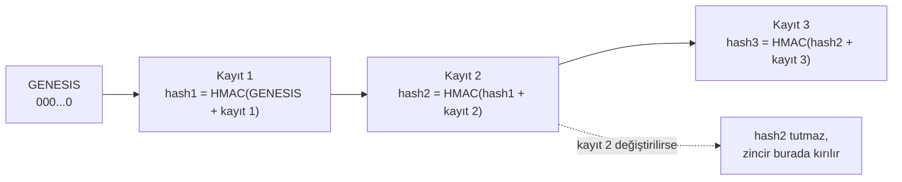

Doğrulama:

```bat
python manage.py log_dogrula
python manage.py log_dogrula --demir demir.txt                  :: son hash'i dışarı yaz
python manage.py log_dogrula --beklenen-son-hash <hash>         :: sondan silme var mı?
```

Dürüst sınırlar:
- Zincir, **ortadaki** bir kaydın değiştirilmesini/silinmesini yakalar. **Sondaki** kayıtların silinmesi tek başına
  fark edilmez; bunun için `--demir` ile son hash'i düzenli olarak dışarı (e-posta, ayrı disk) yazıp
  `--beklenen-son-hash` ile karşılaştır.
- `LOG_HMAC_ANAHTARI` ortam değişkenini veritabanının **dışında** tut. Anahtarı bilen biri zinciri baştan hesaplayabilir.
- Hash zinciri veritabanına erişimi engellemez, değişikliği **görünür** kılar.
- Defter hareketleri de eklenir ama değiştirilmez/silinmez (model düzeyinde); veritabanına doğrudan erişim bunu aşabilir,
  mutabakat komutu böyle bir değişikliği bakiye farkı olarak yakalar.

## Protokol (Arduino ↔ köprü)

Satır satır metin, alanlar `|` ile ayrılır, 9600 baud. Uno'da JSON ayrıştırmak RAM yer; bu yüzden düz metin.
Tam liste `atm_terminal.ino` dosyasının başındaki yorumda. Özet:

| Arduino → köprü | Cevap |
|---|---|
| `KART\|uid` ya da `KART\|uid\|sayac\|mac` (imzalı kart) | `TIP\|MUSTERI/PERSONEL/BLOKE/BILINMIYOR/IMZASIZ` |
| `PIN\|uid\|pin` (+ `\|sayac\|mac`) | `GIRIS\|token\|ad` |
| `PINDEGIS\|token\|eskiPin\|yeniPin` | `PINDEGIS\|TAMAM` |
| `BAKIYE\|token` | `BAKIYE\|tutar` |
| `ISLEM\|token\|C/Y/H\|tutar\|hedef\|anahtar` | `TAMAM\|bakiye\|islemId\|plan` (plan: nakit çekmede `200x8+100x2`) ya da `BEKLE\|talepId\|gereken` |
| `TESLIM\|islemId\|A/H/S` ya da `TESLIM\|islemId\|K\|200x8` | `TESLIM\|ALINDI\|0.00`, `TESLIM\|GERI\|iade` (tam iade) ya da `TESLIM\|KISMI\|iade` (eksik verme) |
| `KASAAC\|uid\|pin` (+ `\|sayac\|mac`) | `BEKLE\|talepId\|gereken` |
| `BEKLEYEN` | `BEKLEYEN\|YOK` ya da `BEKLEYEN\|id\|tur\|tutar\|verilen\|gereken` |
| `DURUM\|talepId` | `DURUM\|verilen\|gereken\|durum\|kalanSn\|ustYetkili\|tur\|islemId\|plan` |
| `ONAY\|talepId\|uid\|pin\|E/H` (+ `\|sayac\|mac`) | `ONAY\|verilen\|gereken\|durum` |

Hata her zaman `HATA|mesaj` (ascii, en fazla 32 karakter). `HATA|Sunucu...` ile başlayan hatalarda terminal `ISLEM`i
aynı idempotency anahtarıyla en fazla 2 kez yeniden dener. Tutar kuruş içerebilir (`100.50`).

## Bilinen sınırlar

- UID kopyalanabilir (MIFARE Classic UID'si klonlanır). Bu yüzden kart tek başına yetmez, PIN de isteniyor. Gerçek
  güvenlik için imzalı/şifreli kart (NTAG 424 DNA, DESFire) ve PN532 gerekir. İmzalı kartın sunucu tarafı ve simülatörü
  hazırdır ("İmzalı kart" bölümü), ama RC522'li gerçek donanım imza üretemez.
- Arduino → köprü arası USB'de PIN düz metindir (aynı bilgisayarda). Köprü → API arası için HTTPS kullan.
- Tutar klavyeden tam TL girilir (kuruş yok). Tek terminal hem müşteri hem yetkili modunda çalışır.
- Terminal, idempotency için yalnızca yeniden deneme yapar; ISLEM cevabı hiç gelmezse işlem sunucuda uygulanmış olabilir ve
  ekranda "Sunucu yanit vermedi" görünür. Aynı anahtarla yeniden gönderince sonucu alırsın; kalıcı çözüm çevrimdışı kuyruk olurdu.
- Varsayılan anahtarlar ve veritabanı parolası (`DJANGO_SECRET_KEY`, `KOPRU_API_ANAHTARI`, `LOG_HMAC_ANAHTARI`, `POSTGRES_PASSWORD`) sadece demo içindir.
- Hash zinciri tek bir sıralı zincir olduğu için, yazan işlemler PostgreSQL'de bir danışma kilidiyle **sıraya girer** (aşağıdaki
  "PostgreSQL ve eşzamanlılık"). Bu doğruluk için bilinçli bir takastır; yatay ölçekleme için zincirin bölümlenmesi gerekir.

## Sıradaki fikirler

1. Kullanıcı ve grup yönetimini de onaya bağlamak.
2. Elle ters kayıt (dört göz ile).
3. İmzalı kartın gerçek donanımda çalışması: PN532 okuyucu + NTAG 424 DNA ve Arduino tarafında SDM okuma.
4. Çevrimdışı "stand-in" mod: sunucu, terminale kısa ömürlü ve imzalı küçük bir limit verir (tasarım taslağı "Çevrimdışı davranış" bölümünde).
5. Risk motoruna ML sinyali (RandomForest / Isolation Forest, simülatörden üretilen sentetik veriyle) ve geçmiş davranış tabanlı eşikler.
6. Müşteriye işlem bildirimi (SMS) ve ön provizyon (hold).
