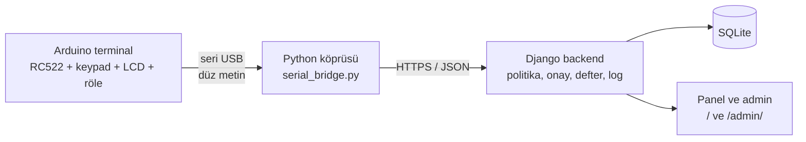
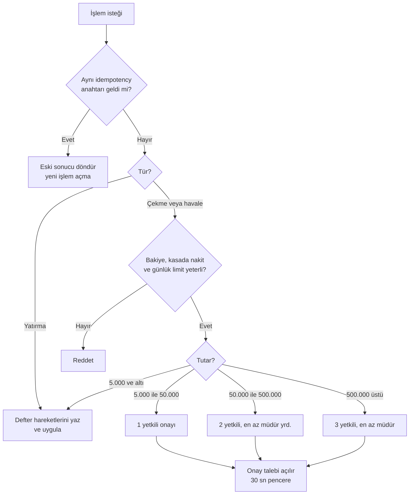
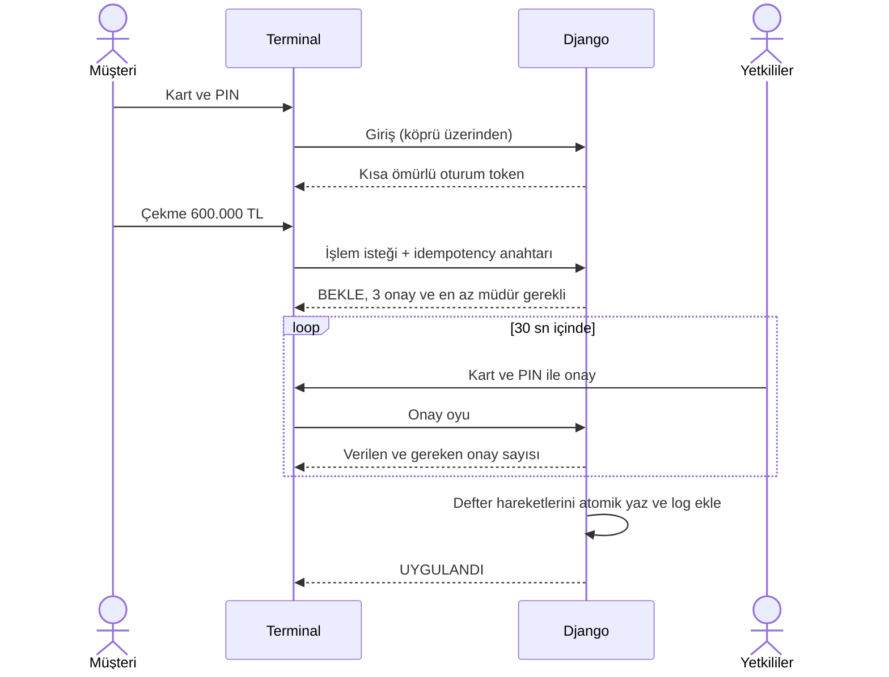
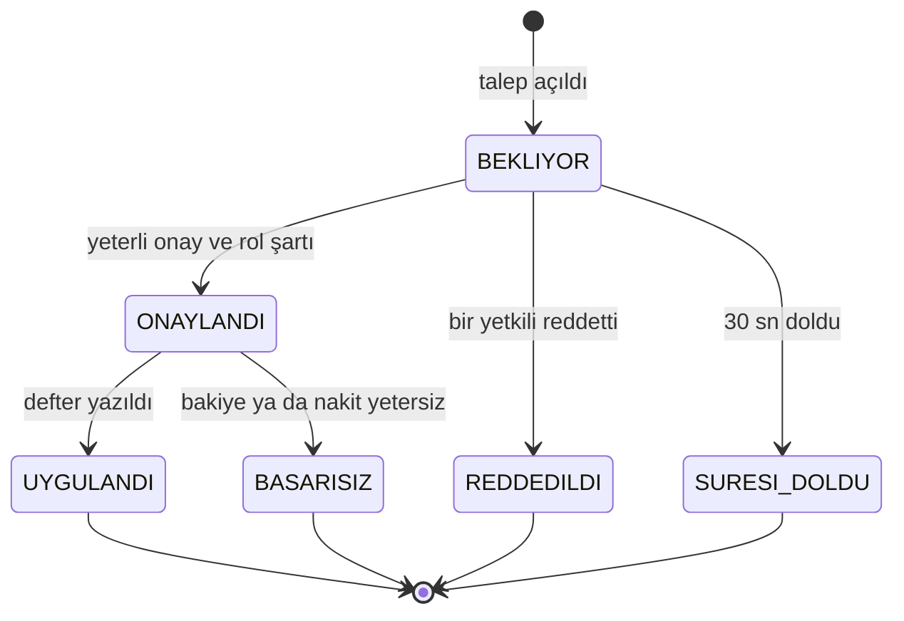
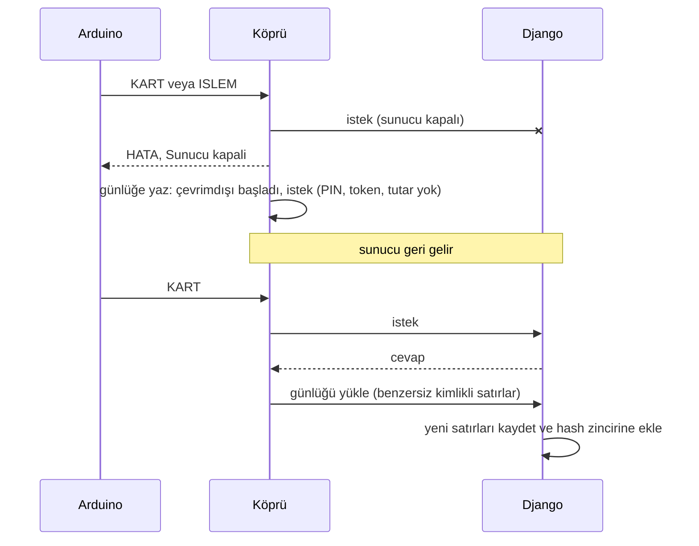
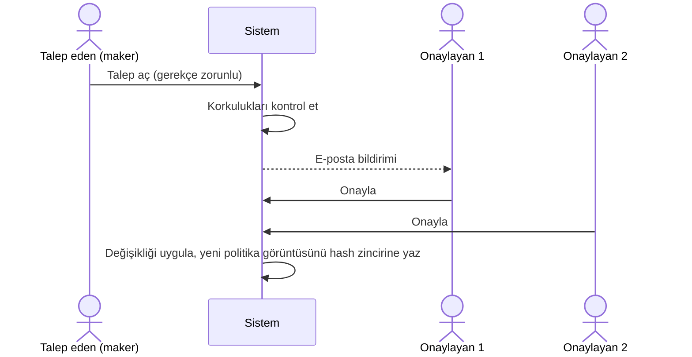
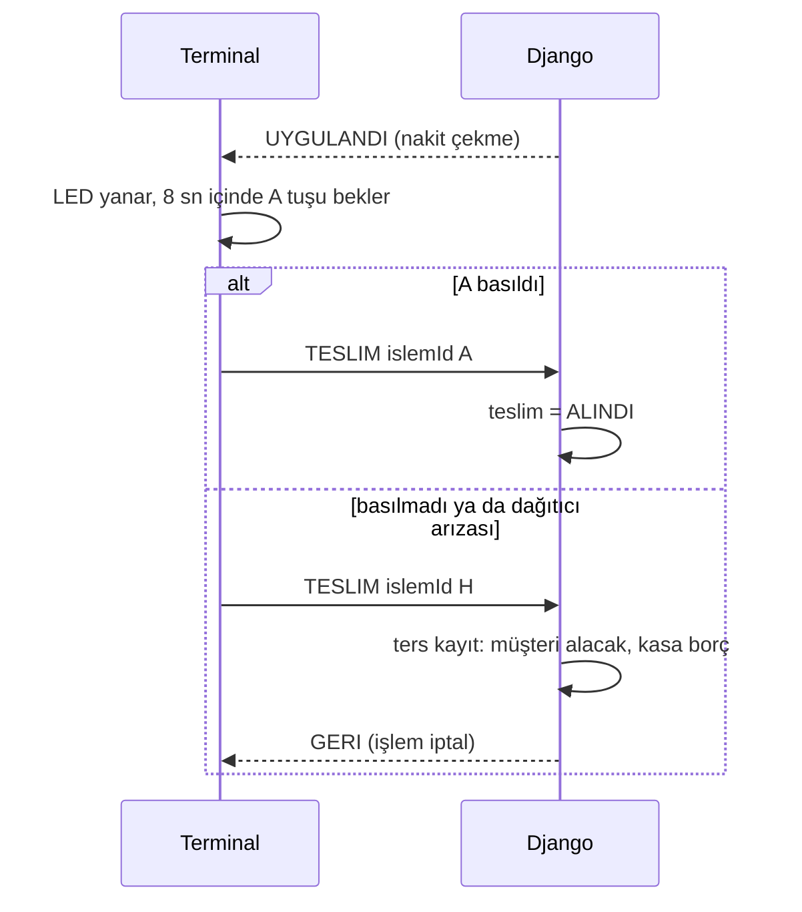
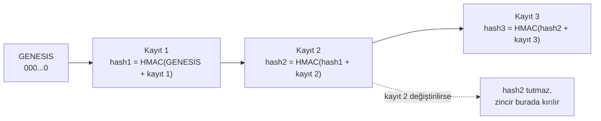

# RFID Banka + Çok İmzalı Kasa

Arduino + RC522 ile kartlı mini ATM. Küçük işlemler direkt geçer, büyük işlemler **N-of-M yetkili onayı** ister
(ör. 5 yetkiliden en az 3'ü, 30 saniye içinde, içlerinden biri müdür). Para hareketleri **çift taraflı deftere**,
her olay **HMAC'li hash zincirine** yazılır; geçmişte bir kayıt değiştirilirse ya da silinirse fark edilir.
Kasa dairesinin kilidi, onay tamamlanınca **röle** ile açılır.

> Bu bir **simülasyon**. RC522 gerçek banka kartlarını (EMV) okuyamaz, yalnızca UID görür. Para sanaldır.



Arduino **hiçbir karar vermez**: kart UID'sini ve tuşları yollar, cevaba göre ekrana yazar. PIN doğrulama, bakiye,
politika, onay kuralları, defter ve log tamamen sunucudadır.

## Özellikler

| Özellik | Nerede | Nasıl görürsün |
|---|---|---|
| **N-of-M onay** (tutara göre 0–3 onay, rol şartı, 30 sn pencere) | `services.py` | README'deki demo |
| **Çift taraflı defter**: her hareket borç/alacak, bakiye defterden doğrulanır | `ledger.py` | `python manage.py gun_sonu_mutabakat` |
| **Idempotency**: aynı istek iki kez gelirse para iki kez çıkmaz | `services.islem_baslat` | Arduino ağ koparsa aynı anahtarla yeniden dener |
| **Günlük limit** + kasada yeterli nakit kontrolü | `Hesap.gunluk_limit` | admin panelinden değiştir |
| **Gün sonu mutabakatı**: defter ↔ bakiye ↔ işlem ↔ hash zinciri | `gun_sonu_mutabakat` | çıkış kodu 1 = fark var |
| **Anomali tespiti** (PIN saldırısı, gece işlemi, hızlı talepler…) | `anomali.py` | `python manage.py anomali_tara`, panel |
| **Kasa dairesi açma**: 3 onay + müdür, sonra röle | `kasa_acma_baslat`, firmware | yetkili kartı, "A:Kasa ac" |
| **PIN trafiği için HTTPS** + düz HTTP koruması | `https_sunucu.py`, köprü | aşağıda "HTTPS" |
| **HMAC'li hash zinciri** denetim kaydı | `hashlog.py` | `python manage.py log_dogrula` |
| **Çoklu terminal** + "imkânsız seyahat" kuralı | `Terminal`, `anomali.py` | admin panelinden terminal ekle |
| **Kuruş desteği** (klavyede `C` tuşu ondalık noktası) | firmware, `_tutar_coz` | `100.50` yaz |
| **Çevrimdışı günlük kuyruğu** (store-and-forward) | köprü, `terminal.py` | sunucuyu kapatıp terminali dene |
| **Bildirimler** (e-posta + SMS simülasyonu) | `bildirim.py` | talep açılınca yetkililere gider |
| **Maker-checker**: politika değişikliği 2 farklı kullanıcının onayını ister, korkuluklar, onaysız değişiklik tespiti | `politika_degisikligi.py` | admin → Politika değişikliği talepleri |
| **RBAC**: rol → yetki matrisi, admin grupları koddan, görev ayrımı denetimi | `rbac.py` | `python manage.py rbac_denetimi` |
| **Hassas yönetim işlemleri için maker-checker** (yetkili ekleme, rol, PIN, bloke, limit, terminal) | `yonetim_talepleri.py` | admin → Yönetim talepleri |
| **Yetkili bütünlüğü**: sahte yetkili/rol/PIN değişikliği veritabanından yapılırsa onaylar kapanır | `personel_butunlugu.py` | `python manage.py personel_goruntu_al` |
| **Ters kayıt + para teslimi**: para alınmazsa çekme otomatik geri alınır (orijinal satırlara dokunmadan) | `services.teslim_bildir` | çekimde 8 sn içinde A tuşuna basma |

## Klasör yapısı

| Yol | Ne var |
|---|---|
| `arduino/atm_terminal/atm_terminal.ino` | Terminal yazılımı (kart, PIN, LCD menü, onay bekleme, röle) |
| `bridge/serial_bridge.py` | Seri port ↔ API köprüsü (`--konsol` ile Arduino'suz da denenir) |
| `backend/banka/models.py` | Müşteri, Hesap, Kart, Personel, Politika, İşlem, HesapHareketi, OnayTalebi, Onay, LogKaydi |
| `backend/banka/services.py` | PIN/bloke, oturum token'ı, politika, onay akışı, idempotency, limit, kasa açma |
| `backend/banka/ledger.py` | Defter satırları ve mutabakat |
| `backend/banka/anomali.py` | Log üzerinde anomali kuralları |
| `backend/banka/hashlog.py` | Hash zinciri ekleme ve doğrulama |
| `backend/banka/terminal.py` | Terminal doğrulama, çevrimdışı günlüğün yüklenmesi |
| `backend/banka/bildirim.py` | E-posta ve SMS (simülasyon) bildirimleri |
| `backend/banka/baglam.py` | İsteğin terminalini log katmanına taşıyan bağlam |
| `backend/banka/politika_degisikligi.py` | Maker-checker, korkuluklar, politika bütünlüğü (onaylı görüntü) |
| `backend/banka/rbac.py` | Rol → yetki matrisi, admin grupları, görev ayrımı denetimi |
| `backend/banka/yonetim_talepleri.py` | Hassas yönetim işlemleri için maker-checker (7 işlem türü) |
| `backend/banka/personel_butunlugu.py` | Yetkili kümesinin onaylı görüntüsü ve sapma tespiti |
| `backend/banka/api.py` | Köprünün konuştuğu JSON API |
| `backend/https_sunucu.py` | Geliştirme için HTTPS sunucusu |
| `backend/banka/tests.py` | Politika, onay, defter, idempotency, limit, anomali, kasa açma, zincir testleri |

## Kurulum (Windows)

```bat
cd backend
python -m venv .venv
.venv\Scripts\activate
pip install -r requirements.txt

python manage.py makemigrations banka
python manage.py migrate
python manage.py seed_demo
python manage.py createsuperuser
python manage.py test
python manage.py runserver
```

Gereken Django sürümü **5.1 veya üstü**. `seed_demo` sahte UID'li demo müşteri/yetkili/politika ve **nakit kasa
hesabı** üretir, PIN'leri yazdırır (müşteriler `1234` / `4321`, yetkililer `1111`…`5555`). Gerçek kartlarının UID'sini
admin panelinden (`/admin/`) gir.

> Şema değiştiyse (ör. defter, günlük limit eklenmesi) eski demo veritabanını sil: `del db.sqlite3`, sonra
> `makemigrations`, `migrate`, `seed_demo` komutlarını tekrar çalıştır. Eski bakiyelerin açılış kaydı olmadığı için
> mutabakat fark gösterirdi.

> Mevcut veritabanın varsa silmene gerek yok: `makemigrations` yeni bir migration (`0003_...`) üretir, `migrate` uygular,
> `seed_demo` eksik terminalleri ve yetkililerin demo iletişim bilgilerini tamamlar, politika ve yetkili kümesi için
> onaylı başlangıç görüntülerini kaydeder, RBAC gruplarını kurar ve 8 demo yönetim kullanıcısı oluşturur
> (`politika_talep`, `politika_onay1-2`, `yonetim_talep`, `yonetim_onay1-3`, `denetci`);
> **şifreleri yalnızca ilk çalıştırmada ekrana yazar**, not al.
> Veritabanın eskiden kalmaysa ve politikaların varsa bir kez `python manage.py politika_goruntu_al` çalıştır.

İkinci terminalde köprü:

```bat
cd bridge
pip install -r requirements.txt
python serial_bridge.py --port COM3 --terminal ATM-01
```

Bir kartın UID'sini öğrenmek için kartı terminale okut; köprü satırı `KART|c518cc4f -> TIP` diye yazdırır.
Seri port aynı anda tek programda açık olabilir, **Arduino IDE'nin Serial Monitor'unu kapat**.

Panel: `http://127.0.0.1:8000/` (staff girişi ister): anomali uyarıları, bekleyen onaylar, son işlemler, defter
hareketleri, hesaplar, zincir durumu.

## Bağlantılar (Uno)

| Parça | Pin |
|---|---|
| RC522 | SDA=10, RST=9, MOSI=11, MISO=12, SCK=13, **3.3V** |
| Keypad 4x4 | satırlar 2,3,4,5 — sütunlar 6,7,8,A0 |
| I2C LCD 16x2 | SDA=A4, SCL=A5 (adres `0x27`, olmazsa `0x3F`) |
| Buzzer | A1 |
| "Para çıkışı" LED'i | A2 |
| Kasa kilidi rölesi (IN) | A3 |

Kütüphaneler (Library Manager): **MFRC522**, **Keypad**, **LiquidCrystal I2C**.
Uno'da RAM dar; metinler bu yüzden `F()` ile flash'ta tutuluyor. "Low memory" uyarısı alırsan Mega ya da ESP32 kullan.

### Kasa kilidi (röle)

Arduino pini kilidi süremez. 5V röle modülü araya girer, kilit **ayrı 12V adaptörden** beslenir:

- Röle modülü: `VCC` → 5V, `GND` → GND, `IN` → A3
- Adaptör `+` → rölenin `COM`; rölenin `NO` → kilidin `+`; kilidin `-` → adaptör `-`
- Kilidin uçlarına ters yönde bir **1N4007 diyot** bağla (bobinin gerilim sıçramasını söndürür)
- Çoğu modül LOW'da çeker. Seninki tersse `atm_terminal.ino` içinde `ROLE_ACIK` ile `ROLE_KAPALI` değerlerini yer değiştir.
- İlk denemede kilit yerine LED ya da rölenin "klik" sesiyle dene. Kilit 5 sn açık kalır (`KILIT_ACIK_MS`).

## Terminal ekranları

16x2 LCD'de görünen ekranlar (metinler `atm_terminal.ino` içindekilerle aynı):


## Kurallar (varsayılan politika, admin panelinden değişir)

| Tutar (çekme / havale) | Gereken onay |
|---|---|
| ≤ 5.000 | Onay yok |
| 5.000 – 50.000 | 1 yetkili |
| 50.000 – 500.000 | 2 yetkili, en az biri müdür yardımcısı veya üstü |
| > 500.000 | 3 yetkili, en az biri müdür |



- Yatırma onaysız geçer ve günlük limite takılmaz.
- **Günlük limit** (varsayılan 1.000.000 TL/hesap) bugünkü uygulanmış ve onay bekleyen çekme/havaleleri sayar.
- Çekme için **kasada yeterli nakit** de gerekir (`seed_demo` kasaya 10.000.000 TL koyar).
- Onaylar talep açıldıktan sonra `ONAY_PENCERESI_SN` (30 sn) içinde toplanmalı, yoksa talep düşer.
- Aynı yetkili iki kez sayılmaz. İşlemi başlatan kendi işlemini onaylayamaz. Herhangi bir yetkili reddedebilir.
- **Mesai dışı** (09–18 dışı ve hafta sonu) onay isteyen işlemlerde **+1 onay** ve **bir üst rol** gerekir.
  Gece denerken fazladan onay istemesini istemiyorsan: `set MESAI_DISI_KURALI=0` (sonra `runserver`).
- Aktif yetkili sayısı ya da gerekli rol yetmiyorsa işlem açılmaz (güvenli tarafta kalır).
- 3 yanlış PIN kartı bloke eder (müşteri ve yetkili). Blokeyi admin panelinden kaldır.

## Akış

600.000 TL çekme örneği (3 onay, en az biri müdür):



Onay talebinin yaşam döngüsü:



## Kasa dairesini açma

Bekleyen talep yokken **müdür yardımcısı ya da müdürün kartını** okut → `A:Kasa ac` → PIN (görevli rolünün bu yetkisi yok, bkz. RBAC). 3 onay gerekir ve en az biri müdür olmalıdır
(`KASA_ACMA_GEREKEN_ONAY`, `KASA_ACMA_EN_AZ_ROL`). Diğer yetkililer kartlarını okutup onaylar; **talebi başlatan kendi
talebini onaylayamaz**, bu yüzden onaylayabilecek başka yeterli yetkili yoksa talep hiç açılmaz (tek müdürün
başlattığı talep sonsuza dek takılırdı). Son onayda sunucu `UYGULANDI` der ve terminal röleyi 5 sn çeker.

## Çift taraflı defter ve mutabakat

Bakiye tek bir sayı değildir; her para hareketi, toplamı sıfır olan borç/alacak satırlarıdır:

| İşlem | Borç | Alacak |
|---|---|---|
| Çekme | müşteri hesabı | kasa |
| Yatırma | kasa | müşteri hesabı |
| Havale | gönderen müşteri | alıcı müşteri |

`Hesap.bakiye` hızlı okuma için tutulan önbelleğdir. `Hesap.acilis_bakiyesi` + defterin net etkisi gerçek bakiyedir.

```bat
python manage.py gun_sonu_mutabakat                 :: bugün
python manage.py gun_sonu_mutabakat --tarih 2026-11-05
```

Komut şunları karşılaştırır, fark varsa çıkış kodu 1 verir ve sonucu denetim loguna yazar:
kayıtlı bakiye ↔ defterden hesaplanan bakiye, her işlemde borç = alacak = tutar, uygulanmış işlemin defter satırı olması,
uygulanmamış işleme ait yetim satır olmaması, hash zincirinin sağlamlığı.

## Idempotency

Ağ koparsa ya da cevap gecikirse aynı istek iki kez gelebilir. Terminal her işlem için rastgele bir **anahtar** üretir;
cevap gelmezse AYNI anahtarla en fazla 2 kez yeniden dener. Sunucu `(hesap, anahtar)` çiftini tekil tutar: ikinci istek
yeni işlem açmaz, ilk işlemin sonucunu döndürür (`"tekrar": true`). Aynı anahtar farklı tutar/hedefle gelirse reddedilir.

## Anomali tespiti

```bat
python manage.py anomali_tara --saat 24        :: yüksek ciddiyette bulgu varsa çıkış kodu 1
```

| Kural | Ciddiyet | Ne yakalar |
|---|---|---|
| `pin_yagmuru` | yüksek | Aynı kimlikte 10 dk içinde 3+ hatalı PIN |
| `dagitik_pin` | yüksek | 10 dk içinde 3+ farklı kimlikte toplam 5+ hatalı PIN |
| `bilinmeyen_kart_tekrar` | orta | Tanımsız kartın 10 dk içinde 3+ kez okutulması |
| `bloke_kart_denemesi` | orta | Bloke kimlikle ısrarlı deneme |
| `hizli_talep` | orta | Aynı hesapta 10 dk içinde 3+ onay talebi |
| `gece_yetkili_islemi` | orta / yüksek | 00:00–05:00 arasında onay ya da kasa açma |
| `imkansiz_seyahat` | yüksek | Aynı kart/yetkili, kısa sürede birbirine uzak iki terminalde (varsayılan eşik 150 km/sa) |
| `farkli_terminal_kisa_surede` | orta | Terminal konumu bilinmiyorsa: aynı kimlik 2 dk içinde iki terminalde |
| `uzun_cevrimdisi` | orta | Terminal 30 dk'dan uzun çevrimdışı kaldı (terminalin kendi beyanı) |
| `teslim_belirsiz` | orta | Nakit çekmenin para teslimi 5 dk'dan uzun süredir bildirilmedi |
| `cok_ters_kayit` | orta | Aynı hesapta 60 dk içinde 3+ ters kayıt (dağıtıcı arızası ya da suistimal) |

Kurallar hash zincirli logdaki olaylara bakar, bulgular panelin üstünde görünür. Kimlik başına son görüldüğü terminal tutulur; terminal koordinatları varsa haversine mesafesi ve hız hesaplanır.
`python manage.py anomali_tara --bildir` yüksek ciddiyetteki bulguları müdür yardımcısı ve üstüne bildirir.

## HTTPS (PIN trafiği)

PIN, Arduino → köprü arası USB'den düz gider (aynı bilgisayar). Köprü → API arası ise ağdan geçebilir; bu yüzden:

- Köprü, **bu bilgisayar dışındaki bir adrese düz HTTP ile bağlanmayı reddeder** (`--guvensiz-http` ile bilerek açılır).
- `DJANGO_HTTPS=1` ise API düz HTTP isteklerini `403` ile reddeder, oturum/CSRF çerezleri `Secure` olur.
- `backend/https_sunucu.py` geliştirme için TLS'li sunucu açar (üretimde gunicorn/waitress + Caddy/nginx kullan).

```bat
mkcert -install
mkcert localhost 127.0.0.1 ::1
set DJANGO_HTTPS=1
python https_sunucu.py --sertifika localhost+2.pem --anahtar localhost+2-key.pem

python serial_bridge.py --port COM3 --api https://127.0.0.1:8443 --ca-dosyasi "<mkcert -CAROOT klasörü>\rootCA.pem"
```

**Neden PIN'i Arduino'da hash'lemiyoruz?** 4 haneli PIN'in 10.000 olasılığı var; hash'i ele geçiren herkes saniyeler içinde
PIN'i bulur, üstelik hash'in kendisi "PIN yerine geçen sır" olur (pass-the-hash). Asıl koruma kanalın şifrelenmesi,
sunucuda yavaş hash (Django PBKDF2) ve deneme sınırıdır. Gerçek sistemlerde PIN, güvenli PIN-pad içinde şifrelenir (PIN block) ve HSM ile doğrulanır.

## Arduino olmadan deneme (köprü konsol modu)

```bat
python serial_bridge.py --konsol
```

```
KART|a0a0a001
PIN|a0a0a001|1234                 <- GIRIS|<token>|Ali Yilmaz
ISLEM|<token>|C|600000||anahtar1  <- BEKLE|1|3   (token 120 sn geçerli)
ISLEM|<token>|C|600000||anahtar1  <- BEKLE|1|3   (aynı anahtar: yeni talep açılmaz)
ONAY|1|b0b0b001|1111|E            <- ONAY|1|3|BEKLIYOR
ONAY|1|b0b0b002|2222|E
ONAY|1|b0b0b003|3333|E            <- 3 onay var ama müdür yok: BEKLIYOR, üst rol lazım
ONAY|1|b0b0b005|5555|E            <- UYGULANDI

KASAAC|b0b0b003|3333              <- BEKLE|2|3   (kasa dairesi açma talebi; Cem müdür yrd.)
ONAY|2|b0b0b001|1111|E            ... Ayşe, Burak, Elif onaylar; Cem kendi talebini onaylayamaz,
                                      görevli (Ayşe) talebi başlatamaz (HATA|Bu rol kasa acma talebi baslatamaz)
```

## Terminaller ve imkânsız seyahat

Her köprü kendini `--terminal ATM-01` ile tanıtır (`X-Terminal-Id` başlığı). Terminaller admin panelinde tanımlıdır
(kod, ad, enlem, boylam); tanımsız ya da kapatılmış terminal `403` alır, başlık yoksa `ATM-01` varsayılır.
Terminal kodu **her denetim kaydına** ve `Islem.terminal` alanına yazılır (hash zincirine de girer).

`seed_demo` iki terminal ekler: `ATM-01` (Ankara) ve `ATM-02` (İstanbul), aralarında yaklaşık 350 km var.
Aynı kartı iki terminalde birkaç saniye arayla kullanırsan `imkansiz_seyahat` alarmı çıkar. Birbirine 1 km'den yakın
terminaller aynı şube sayılır. Kasa açma talebini başlatan terminalin röle kilidi açılır, çünkü yalnızca talebi başlatan
terminal onu sorgular.

## Kuruş

Klavyede tutar girerken `C` tuşu ondalık noktasıdır (en fazla 2 hane): `1 0 0 C 5` → `100.5` → `100,50 TL`.
Sunucu nokta ve virgülü kabul eder, 3. ondalık haneyi **reddeder** (sessizce yuvarlamaz) ve `1,000.50` gibi
belirsiz binlik ayraçlarını da reddeder. Defter kuruşla dengeli kalır.

## Çevrimdışı davranış

Terminal sunucuya ulaşamazsa **para işlemi yapılmaz** ("Sunucu kapali"). Bu bilinçli bir sınırdır: PIN doğrulayıcıları
ve bakiyeler yalnızca sunucuda durur. Terminale koymak, "PIN'i Arduino'da hash'lemiyoruz" kararıyla çelişirdi ve
çevrimdışı bir çekimi kimse denetleyemezdi.

Bunun yerine köprü **store-and-forward günlük** tutar (`bridge/cevrimdisi_kuyruk.jsonl`):



- Köprü sunucuya bağlanamayınca 5 sn boyunca hiç denemeden "kapalı" der (devre kesici), Arduino beklemez.
- Günlüğe yalnızca olay türü, komut adı ve kart UID'si yazılır. **PIN, token ve tutar yazılmaz.**
- Her satırın benzersiz kimliği vardır; yükleme cevabı kaybolup yeniden gönderilse bile sunucuda bir kez kaydedilir.
- Satırdaki zaman **terminalin beyanıdır**: 7 günden eskiyse ya da gelecekteyse `zaman_guvenilir=false` olarak işaretlenir.
- Cevap gecikirse (bağlantı var, yanıt yok) terminal çevrimdışı sayılmaz: istek uygulanmış olabilir, Arduino aynı
  idempotency anahtarıyla tekrar dener.
- Dosya 1000 satırı geçmez (en eskiler atılır).

Çevrimdışıyken bile işlem yapılabilen bir "stand-in" mod (önceden yetkilendirilmiş küçük limit) bilinçli olarak yok; bkz. sıradaki fikirler.

## Bildirimler

| Olay | Kime | Kanal |
|---|---|---|
| Onay talebi açıldı (çekme/havale ya da kasa açma) | Aktif yetkililer, **talebi başlatan hariç** | e-posta + SMS |
| Kasa dairesi açıldı | Müdür yardımcısı ve üstü | e-posta + SMS |
| Yüksek ciddiyetli anomali (`anomali_tara --bildir`) | Müdür yardımcısı ve üstü, aynı bulgu 6 saatte bir | e-posta + SMS |

- E-posta Django'nun e-posta altyapısıyla gider; varsayılan olarak **konsola yazar**. Gerçek SMTP için
  `DJANGO_EMAIL_BACKEND=django.core.mail.backends.smtp.EmailBackend` ve `EMAIL_HOST` gibi ayarları ver.
- **SMS gerçek değildir**: kayıt `SMS (simülasyon)` olarak tutulur ve loga yazılır; gerçek bir sağlayıcı bağlı değil.
- Yetkililerin e-posta ve telefonu admin panelinde (`Personel`) girilir. Demo adresleri `.example` uzantılıdır, gerçek değildir.
- Bildirim hatası **işlemi bozmaz**: hata `Bildirim` tablosuna `BASARISIZ` olarak yazılır. Bildirimler işlem
  commit edildikten sonra gönderilir. Panelde "Son bildirimler" bölümü var.
- Bloke ya da pasif yetkililere bildirim gitmez.

## Politika değişikliği: maker-checker

Onay politikası (hangi tutarda kaç onay) sistemin en kritik ayarıdır; tek kişi "50.000 TL'ye kadar onaysız" yazarsa
bütün N-of-M düzeni boşa gider. Bu yüzden **Politika tablosu admin panelinde salt okunurdur** (ekleme, değiştirme ve
silme kapalı). Değişiklik yalnızca "Politika değişikliği talepleri" ile yapılır:



- Talep eden kendi talebini **onaylayamaz**, aynı kullanıcı iki kez sayılmaz, herhangi bir onaylayan reddedebilir,
  talep 24 saat içinde onaylanmazsa düşer. Aynı politika için aynı anda tek bekleyen talep olabilir.
- Yetki Django izinleriyle verilir: `politika_talep_et` (maker) ve `politika_onayla` (checker). `seed_demo` iki grup
  ve üç demo kullanıcı kurar (1 talep eden + 2 onaylayan). Gereken onay sayısı `POLITIKA_DEGISIKLIK_ONAY` (varsayılan 2).
- Aralıkta yalnızca **alt limit** girilir; üst limit bir sonraki aralığın alt limitinden türetilir, böylece boşluk ve
  çakışma olamaz. Yeni eşik eklemek bir aralığı böler, silmek öncekini uzatır.

**Korkuluklar (onaylansa bile aşılamaz, panelden değişmez, `settings.py`'dedir):**

| Kural | Neden |
|---|---|
| Onaysız (0 onay) aralık en fazla `POLITIKA_ONAYSIZ_AZAMI_TUTAR` (10.000 TL) olabilir | Büyük işlemi onaysız bırakmak engellenir |
| Tutar arttıkça gereken onay sayısı ve rol azalamaz | "Daha büyük tutar, daha az kontrol" olamaz |
| En üst aralık en az `POLITIKA_EN_UST_ARALIK_MIN_ONAY` (2) onay ister | En büyük işlem tek imzayla geçemez |
| İlk aralık 0'dan başlar, alt limitler tekil, onay ≤ `POLITIKA_MAKS_ONAY` | Kapsama ve tutarlılık |

**Onaysız değişikliği yakalamak (bütünlük):** Her onaylı değişiklikte politika tablosunun özeti (SHA-256) hash zincirine
yazılır. Tablo bu "onaylı görüntü"den farklıysa (ör. veritabanına doğrudan müdahale) sistem **kapalı kalır**: her
çekme/havale en sıkı kuralla (3 onay, müdür) istenir, `politika_butunluk_ihlali` loga yazılır (saatte bir) ve
`gun_sonu_mutabakat` hata verir. Tablo onaysız değiştirilmişken yeni bir politika talebi de uygulanmaz.
`politika_goruntu_al` ilk kurulumda başlangıç görüntüsünü yazar; tablo farklıyken meşrulaştırmayı reddeder, bilerek
yapılacaksa `--zorla` ister ve denetim kaydına işlenir.

Dürüst sınırlar: Maker-checker, kullanıcı yönetimi kadar güvenlidir. Bir superuser ek kullanıcı oluşturup kendi talebini
başka hesapla onaylayabilir; gerçek sistemde kullanıcı ve yetki yönetimi de aynı şekilde onaya bağlı olurdu. Tek talep,
geçerli bir politika kümesi bırakmak zorundadır (ara geçersiz durum yok). Kasa açma kuralı (`KASA_ACMA_*`) ve
korkuluk eşikleri ayarlardadır, yani değişiklikleri kod incelemesinden geçer.

## Ters kayıt ve para teslimi

Nakit çekmede "UYGULANDI" paranın müşteriye ulaştığı anlamına gelmez. Bu yüzden her çekme `teslim=BEKLIYOR` ile başlar ve
**teslim bildirimi** bekler:



- **Orijinal defter satırlarına dokunulmaz.** Geri alma, yeni bir `TERS_KAYIT` işleminin ters borç/alacak satırlarıdır
  (çekmede: müşteri **alacak**, kasa **borç**). Bir çekme en fazla bir kez ters kaydedilir (veritabanı kısıtı).
- Teslimi yalnızca **işlemi başlatan terminal**, işlemden sonra `TESLIM_PENCERESI_SN` (120 sn) içinde bildirebilir.
  Aynı bildirim tekrarlanırsa aynı sonuç döner (ağ kopması güvenli). Bildirilen sonuçla çelişen ikinci bildirim reddedilir.
- Yalnızca **nakit çekme** ters kaydedilir. Yatırma ve havalenin geri alınması alıcının bakiyesine ve rızasına bağlı
  olduğu için bilinçli olarak kapsam dışıdır.
- Ters kaydedilen çekme günlük limiti tüketmez; aynı idempotency anahtarıyla yeniden gelen istek "başarılı" döndürmez.
- Ters kayıtlar müdür yardımcısı ve üstüne bildirilir. `gun_sonu_mutabakat` her ters kaydın uygulanmış bir çekmeyi
  (aynı hesap, aynı tutar) geri aldığını ve geri alınmış her çekmenin tam bir ters kaydı olduğunu doğrular; teslimi
  10 dk'dan uzun süredir bildirilmeyen çekmeleri uyarı olarak listeler. Anomali tarayıcı da bunları (`teslim_belirsiz`,
  `cok_ters_kayit`) işaretler.
- **Simülasyon notu:** Gerçek ATM'de "para alındı" bilgisini dağıtıcının sensörü verir. Burada A tuşu o sensörü taklit
  eder; bu yüzden bir müşteri parayı alıp tuşa basmayarak iade alabilirdi. Gerçek bir sensörde bu mümkün olmaz.
- Elle ters kayıt (terminal hiç bildirmediyse) bilinçli olarak yok: tek kişinin yapacağı bir geri alma da dört göz
  isterdi. Belirsiz teslimler uyarı olarak görünür ve incelenir.

## RBAC: roller ve yetkiler

İki düzlem var ve ikisinde de "kim neyi yapabilir" tek yerde, kodda yazılıdır (`rbac.py`).

**1. Terminal (kart) düzlemi: yetkililerin rolleri**

| Yetki | Görevli | Müdür yrd. | Müdür |
|---|:---:|:---:|:---:|
| Çekme/havale talebini onaylama (`ISLEM_ONAYLA`) | ✓ | ✓ | ✓ |
| Kasa açma talebini onaylama (`KASA_AC_ONAYLA`) | ✓ | ✓ | ✓ |
| Kasa açma talebi **başlatma** (`KASA_AC_BASLAT`) | | ✓ | ✓ |

Rol seviyesi hâlâ onay politikasında ("en az biri müdür") kullanılır; yetki matrisi ise eylemlere bakar. Yetkisi olmayan
rolün isteği `rol_yetersiz` ile reddedilir ve `rbac_reddi` olarak loga yazılır.

**2. Yönetim (admin) düzlemi: Django grupları**

| Grup | Ne yapabilir |
|---|---|
| Politika Talep Eden / Politika Onaylayan | Onay politikasında değişiklik talep eder / onaylar |
| Yönetim Talep Eden / Yönetim Onaylayan | Hassas yönetim işlemlerini (aşağıda) talep eder / onaylar |
| Denetçi | Her şeyi **okur**, hiçbir şeyi değiştiremez |

- Gruplar ve izinleri **koddadır** (`YONETIM_GRUPLARI`); `python manage.py rbac_kur` bunları admin'e uygular (idempotent,
  bilinmeyen izin kodunda hata verir). Elle yapılan grup değişiklikleri `rbac_denetimi` ile yakalanır.
- **Görev ayrımı (SoD):** Aynı kişi hem talep eden hem onaylayan olamaz (`politika_talep_et` ↔ `politika_onayla`,
  `yonetim_talep_et` ↔ `yonetim_onayla`), denetçi hiçbir yazma iznine sahip olamaz.
  `python manage.py rbac_denetimi` bunları denetler, ihlalde çıkış kodu 1 verir; superuser sayısını da uyarı olarak yazar
  (superuser her izne sahiptir, günlük işlerde kullanma).

## Hassas yönetim işlemleri (maker-checker)

N-of-M onayın güvencesi, onaylayanların kim olduğuna bağlıdır. Yönetici tek başına sahte bir yetkili ekleyebilir, PIN'ini
sıfırlayıp onay verebilir, bloke kartı açabilir ya da limiti yükseltebilirse bütün düzen boşa gider. Bu yüzden aşağıdaki
işlemler admin'den **doğrudan yapılamaz** (ilgili alanlar salt okunur, ekleme/silme kapalı); "Yönetim talepleri" ile
yapılır: bir kullanıcı talep açar, işlemin ağırlığına göre BAŞKA kullanıcılar onaylar, son onayda uygulanır.

| İşlem | Onay sayısı | Korkuluk |
|---|---|---|
| Yetkili ekle | 2 (müdür ise 3) | Kart UID tekil, telefon zorunlu (ilk PIN oraya gider) |
| Yetkili rolünü değiştir | yükseltme 2 (müdür yapma 3), düşürme 1 | En az 4 aktif yetkili ve en az 1 aktif müdür kalmalı |
| Yetkiliyi aktif/pasif yap | aktif etme 2, pasif etme 1 | Aynı asgari küme kuralı |
| Yetkili PIN'ini sıfırla | 2 | Telefon kayıtlı olmalı |
| Bloke kaldır | yetkili 2, müşteri kartı 1 | Hedef gerçekten bloke olmalı |
| Günlük limit değiştir | artırma 2, azaltma 1 | 0 < limit ≤ `HESAP_GUNLUK_LIMIT_AZAMI` (5.000.000 TL) |
| Terminal aç/kapat | açma 2, kapatma 1 | — |

Koruyucu yönler (rol düşürme, pasif yapma, limit azaltma, terminal kapatma) az onay, genişletici yönler çok onay ister.
Onay sayıları `YONETIM_ONAY_SAYILARI` ayarındadır.

- Politika değişikliğindeki kuralların aynısı geçerlidir: talep eden kendi talebini onaylayamaz, aynı kullanıcı iki kez
  sayılmaz, herhangi bir onaylayan reddedebilir, talep 24 saatte düşer, aynı hedef için tek bekleyen talep olur
  (ör. aynı yetkili için hem rol hem PIN talebi aynı anda açılamaz), gerekçe zorunludur. Her adım hash zincirine yazılır.
- **PIN'ler asla talebe yazılmaz ve hiçbir kullanıcıya gösterilmez:** uygulama anında rastgele üretilir (aynı rakamlı ve
  ardışık PIN'ler hariç) ve yetkilinin **kendi telefonuna** SMS ile iletilir. Simülasyonda SMS içeriği yalnızca
  `banka.bildirim` log satırında görünür; bildirim kaydında ve panelde görünmez.
- Bilinçli kapsam dışı: müşteri kartı tanımlama ve müşteri PIN'i admin'den hâlâ yapılabilir (gerçek bankada PIN mailer ve
  HSM ile). Bu, bilinen bir açıktır, bkz. sıradaki fikirler.

## Yetkili bütünlüğü

Politika tablosunda olduğu gibi yetkili kümesi de veritabanından doğrudan değiştirilebilir. Bu yüzden her ONAYLI
değişiklikte yetkili kümesinin özeti (kart UID, rol, aktiflik, PIN hash'inin özeti) hash zincirine yazılır. Küme bu
görüntüden farklıysa (ör. veritabanına sahte müdür eklendi, bir yetkilinin rolü ya da PIN'i değiştirildi):

- Çekme/havale **onayları ve kasa açma talepleri kapanır** (`butunluk` hatası), `personel_butunluk_ihlali` loga yazılır (saatte bir),
- `gun_sonu_mutabakat` hata verir, panel kırmızı uyarı gösterir,
- yetkili kümesini ilgilendiren yeni talepler uygulanmaz (tamper'ı meşrulaştırmamak için).

Sistemin kendi güncellemeleri (3 yanlış PIN sonrası bloke, hatalı deneme sayacı) ve iletişim bilgileri özete girmez, yani
yanlış alarm üretmez. `personel_goruntu_al` ilk kurulum içindir; küme farklıyken meşrulaştırmayı reddeder, bilerek
yapılacaksa `--zorla` ister ve denetim kaydına işlenir.

Dürüst sınırlar: Bloke durumunun veritabanından kaldırılması özete girmediği için bu yolla yakalanmaz (kalan açık; yalnızca
yönetim yolu kapatıldı). Maker-checker kullanıcı yönetimi kadar güvenlidir: bir superuser ek kullanıcı oluşturup kendi
talebini başka hesapla onaylatabilir; gerçek sistemde kullanıcı ve yetki yönetimi de aynı şekilde onaya bağlı olurdu.

## Hash zinciri

Her kayıt: `HMAC-SHA256(anahtar, önceki_hash | sıra | zaman | olay | veri)`.



Doğrulama:

```bat
python manage.py log_dogrula
python manage.py log_dogrula --demir demir.txt                  :: son hash'i dışarı yaz
python manage.py log_dogrula --beklenen-son-hash <hash>         :: sondan silme var mı?
```

Dürüst sınırlar:
- Zincir, **ortadaki** bir kaydın değiştirilmesini/silinmesini yakalar. **Sondaki** kayıtların silinmesi tek başına
  fark edilmez; bunun için `--demir` ile son hash'i düzenli olarak dışarı (e-posta, ayrı disk) yazıp
  `--beklenen-son-hash` ile karşılaştır.
- `LOG_HMAC_ANAHTARI` ortam değişkenini veritabanının **dışında** tut. Anahtarı bilen biri zinciri baştan hesaplayabilir.
- Hash zinciri veritabanına erişimi engellemez, değişikliği **görünür** kılar.
- Defter hareketleri de eklenir ama değiştirilmez/silinmez (model düzeyinde); veritabanına doğrudan erişim bunu aşabilir,
  mutabakat komutu böyle bir değişikliği bakiye farkı olarak yakalar.

## Protokol (Arduino ↔ köprü)

Satır satır metin, alanlar `|` ile ayrılır, 9600 baud. Uno'da JSON ayrıştırmak RAM yer; bu yüzden düz metin.
Tam liste `atm_terminal.ino` dosyasının başındaki yorumda. Özet:

| Arduino → köprü | Cevap |
|---|---|
| `KART\|uid` | `TIP\|MUSTERI/PERSONEL/BLOKE/BILINMIYOR` |
| `PIN\|uid\|pin` | `GIRIS\|token\|ad` |
| `BAKIYE\|token` | `BAKIYE\|tutar` |
| `ISLEM\|token\|C/Y/H\|tutar\|hedef\|anahtar` | `TAMAM\|bakiye\|islemId` ya da `BEKLE\|talepId\|gereken` |
| `TESLIM\|islemId\|A/H` | `TESLIM\|ALINDI` ya da `TESLIM\|GERI` (ters kayıt yapıldı) |
| `KASAAC\|uid\|pin` | `BEKLE\|talepId\|gereken` |
| `BEKLEYEN` | `BEKLEYEN\|YOK` ya da `BEKLEYEN\|id\|tur\|tutar\|verilen\|gereken` |
| `DURUM\|talepId` | `DURUM\|verilen\|gereken\|durum\|kalanSn\|ustYetkili\|tur\|islemId` |
| `ONAY\|talepId\|uid\|pin\|E/H` | `ONAY\|verilen\|gereken\|durum` |

Hata her zaman `HATA|mesaj` (ascii, en fazla 32 karakter). `HATA|Sunucu...` ile başlayan hatalarda terminal `ISLEM`i
aynı idempotency anahtarıyla en fazla 2 kez yeniden dener. Tutar kuruş içerebilir (`100.50`).

## Bilinen sınırlar

- UID kopyalanabilir (MIFARE Classic UID'si klonlanır). Bu yüzden kart tek başına yetmez, PIN de isteniyor. Gerçek
  güvenlik için imzalı/şifreli kart (NTAG 424 DNA, DESFire) ve PN532 gerekir.
- Arduino → köprü arası USB'de PIN düz metindir (aynı bilgisayarda). Köprü → API arası için HTTPS kullan.
- Tutar klavyeden tam TL girilir (kuruş yok). Tek terminal hem müşteri hem yetkili modunda çalışır.
- Terminal, idempotency için yalnızca yeniden deneme yapar; ISLEM cevabı hiç gelmezse işlem sunucuda uygulanmış olabilir ve
  ekranda "Sunucu yanit vermedi" görünür. Aynı anahtarla yeniden gönderince sonucu alırsın; kalıcı çözüm çevrimdışı kuyruk olurdu.
- SQLite geliştirme içindir. Varsayılan anahtarlar (`DJANGO_SECRET_KEY`, `KOPRU_API_ANAHTARI`, `LOG_HMAC_ANAHTARI`) sadece demo içindir.

## Sıradaki fikirler

1. Müşteri kartı tanımlama ve müşteri PIN'ini de onaya bağlamak (PIN mailer benzeri tek seferlik teslim).
2. Bloke durumunu da log tabanlı doğrulamak (veritabanından bloke kaldırmayı yakalamak).
3. Kullanıcı ve grup yönetimini de onaya bağlamak.
4. Elle ters kayıt (dört göz ile).
5. İmzalı kart (NTAG 424 DNA) ile klonlanamayan kimlik.
6. Çevrimdışı "stand-in" mod: sunucu, terminale kısa ömürlü ve imzalı küçük bir limit verir.
7. Anomali skorlamasında istatistik (ör. Isolation Forest) ve geçmiş davranış tabanlı eşikler.
8. Müşteriye işlem bildirimi (SMS) ve ön provizyon (hold).
9. GitHub Actions ile her push'ta `python manage.py test`.
